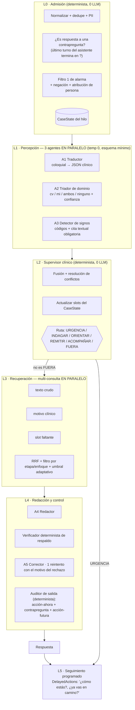

> **Propuesta externa, no aprobada.** Copia literal del documento recibido el 2026-10-21 (`arquitectura-correcciones.md`). Se conserva como anexo del [plan de migración](../plan-migracion-rag2.md), que verifica sus afirmaciones y la viabilidad de cada cambio (ver §2.5, §4 y §5 del plan: algunas cifras no coinciden con `RAG_2.xlsx`).

# Correcciones de arquitectura — chatbot cardio-materno

Revisión del repositorio `chatbot-cardio-materno` (commit `57e23d8`) y de la base RAG
(`RAG.xlsx`, 1.600 registros / `knowledge/kb/entries.jsonl`).
Objetivo: dejar de descartar consultas, indagar de verdad y dejar de escalar a urgencias por
defecto, con una arquitectura de agentes en capas, en paralelo y con filtros de supervisión.

---

## 1. Causas raíz encontradas (con archivo)

### Por qué escala a urgencias con demasiada facilidad

| # | Causa | Dónde |
|---|---|---|
| U1 | `support_ratio()` **resta** `REFERRAL_WORDS` de las palabras de la frase antes de medir el respaldo. Una frase compuesta solo por palabras de remisión queda con cero raíces → `return 1.0` → **siempre aprobada**. Es la única clase de frase que el verificador no puede rechazar. | `domain/grounding.py:support_ratio` |
| U2 | Si **una** frase citada falla, se descarta toda la redacción y se imprime `literal_text(entry)`: la respuesta completa del registro (hasta 710 car.). En la base actual los registros `Indagar` mezclan contrapreguntas con avisos de urgencia, así que el literal arrastra el aviso. | `application/grounded_reply.py:compose_grounded_reply` |
| U3 | `system_prompt_v5.md` ordena explícitamente mandar a urgencias ante una lista amplísima de síntomas ("dolor fuerte en el pecho, dificultad para respirar…"). Es instrucción directa de escalar. | `prompts/system_prompt_v5.md` |
| U4 | `AlarmRule.matches()` se activa si el texto **contiene el nombre del signo**, y el prompt de análisis le pide al modelo escribir ese nombre exacto al inicio de `reported_symptoms`. El modelo lo escribe por aproximación y **la regla se dispara sola**: profecía autocumplida. | `domain/alarms.py:matches` + `prompts/analysis_prompt_v6.md` |
| U5 | Los patrones del filtro 1 son look-aheads muy laxos (RN-MI-01: contexto de embarazo **+** cualquier `sangr\w*│manchad\w*` en el mensaje) y `detect_alarms` **no interpreta negaciones ni atribución de persona**: "no he sangrado", "mi hermana sangró" o "me da miedo sangrar" activan urgencia inmediata. | `knowledge/alarm_rules.json`, `domain/alarms.py:detect_alarms` |
| U6 | Con `is_immediate` se devuelve **solo** el mensaje fijo y se descarta `agent_reply`: no hay orientación para el momento, no hay pregunta por el estado y la conversación se cierra. | `application/alarm_policy.py:compose_reply` |

### Por qué descarta consultas (fuera de alcance / abstención)

| # | Causa | Dónde |
|---|---|---|
| D1 | `effective_scope()` solo protege el mensaje si hay `reported_symptoms` o `reported_signs`. **Las respuestas a una contrapregunta** ("sí", "desde ayer", "no sé") devuelven listas vacías → `fuera_de_alcance`. Es la causa principal. | `application/scope.py:effective_scope` |
| D2 | La rama `OUT_OF_SCOPE` devuelve `record=False`: no se guarda nada y **el hilo ni se toca**. El turno siguiente vuelve sin contexto y se descarta otra vez: bucle de descarte. | `application/conversation_service.py:_route`, `_finish` |
| D3 | `RetrievalStatus != SUFFICIENT` → `ABSTENTION_TEXT`, un texto fijo **sin pregunta y sin acción**. Un fallo de recuperación se convierte en abandono del usuario. | `conversation_service.py:_answer`, `grounded_reply.ABSTENTION_TEXT` |
| D4 | `build_evidence_query` restringe el dominio con `analysis.domain`. Un error de triage en el **primer** turno (el más frecuente, cuando aún no se sabe nada) confina la búsqueda a la mitad equivocada del corpus → `INSUFFICIENT` → abstención. | `application/evidence.py:build_evidence_query` |
| D5 | `num_ctx = 4096` con `analysis_prompt_v6` + 20 reglas con ejemplos + hilo + 6 mensajes: el contexto se trunca y el modelo pierde justamente los ejemplos de alcance, que están al final. | `.env.example:30` |

### Por qué no indaga

| # | Causa | Dónde |
|---|---|---|
| I1 | **No existe estado de indagación.** El hilo guarda `summary` en texto libre. Nada registra qué datos faltan, cuántas preguntas se hicieron ni obliga a un segundo turno. | `domain/conversation.py` |
| I2 | El prompt de respuesta permite **máximo 2 frases sin cita**, de las cuales solo una puede ser pregunta, y además es opcional. El sistema está limitado por diseño a ≤1 contrapregunta por turno, y puede no hacer ninguna. | `prompts/reply_prompt_v3.md` |
| I3 | El corpus `Indagar` está escrito como si el usuario pidiera indagación ("…¿Qué información necesitas?"), algo que nadie escribe en WhatsApp. El embedding del registro queda dominado por esa coletilla meta y no por el síntoma. | `knowledge/kb/entries.jsonl` |
| I4 | `Focus` solo admite `Indagar`/`Solucionar`: la etapa de la conversación **no puede dirigir la recuperación**. No hay forma de pedir "dame registros de indagación de nivel 2" ni "dame acompañamiento". | `domain/knowledge.py:Focus` |
| I5 | Un único mega-prompt de análisis resuelve 7 campos heterogéneos (hilo, dominio, resumen, síntomas, códigos, query, alcance) en una sola llamada, y de él dependen alarma, alcance y RAG. Es la tarea más difícil posible para un 24B local y no tiene redundancia ni supervisión. | `prompts/analysis_prompt_v6.md` |
| I6 | Todo es estrictamente secuencial (análisis → RAG → respuesta) y el dispatcher de WhatsApp tiene **un solo trabajador**. No hay paralelismo del que colgar agentes de verificación. | `conversation_service.py`, `adapters/inbound/whatsapp/dispatcher.py` |

---

## 2. Arquitectura objetivo: agentes pequeños, en capas y en paralelo

**Por qué funciona con modelos locales de 8–24B:** cada agente resuelve una tarea pequeña con
un esquema JSON de 2–4 campos y un prompt corto, en vez de una tarea de 7 campos con un prompt
de 56 líneas más 20 reglas. Las decisiones de riesgo (alarma, alcance, ruta) las toma código
determinista con la salida de tres agentes redundantes, no un solo modelo.

---

## 3. Lista de cambios

### Bloque A — Dejar de escalar a urgencias (prioridad 1)

1. **`domain/grounding.py`** — eliminar la resta de `REFERRAL_WORDS` en `support_ratio`. Una
   frase de remisión debe respaldarse como cualquier otra. Sustituirla por una lista blanca
   cerrada: solo se acepta sin respaldo el texto **exacto** de `alarm_rules.json → messages`.
2. **`application/grounded_reply.py`** — no volcar el registro completo. Si una frase falla,
   mostrar solo **la primera oración** del registro citado más la contrapregunta pendiente del
   `CaseState`. El literal íntegro es lo que hoy arrastra avisos de urgencia ajenos al caso.
3. **`application/alarm_policy.py::compose_reply`** — con `is_immediate`, componer
   `mensaje_fijo + acción_para_el_momento + pregunta_de_estado`, no solo el mensaje fijo.
   La regla determinista **nunca cierra la conversación**.
4. **`domain/alarms.py::matches`** — quitar la activación por "el texto contiene el nombre del
   signo". Dejar solo patrones explícitos; el nombre canónico entra por `reported_signs` (A3).
5. **`domain/alarms.py::detect_alarms`** — añadir ventana de negación (`no`, `nunca`, `sin`,
   `ya no`, `me da miedo que`) y de tercera persona (`mi hermana`, `una vecina`, `le pasó a`)
   en los 6 tokens previos al match. Hoy el criterio es "ante la duda, falso positivo", y ese
   criterio es justamente el que produce el comportamiento reportado.
6. **`prompts/system_prompt_v5.md`** — borrar la instrucción de mandar a urgencias. La decisión
   de urgencia es de L0/L2, nunca del redactor.
7. **A3 (nuevo agente)** — un código de signo solo cuenta si viene con `evidencia_textual`, una
   subcadena literal del mensaje del usuario. El supervisor **verifica la subcadena**; si no
   está, descarta el código. Esto corta la profecía autocumplida de U4.

### Bloque B — Dejar de descartar (prioridad 1)

8. **`application/scope.py`** — `effective_scope` fuerza `en_alcance` cuando el último mensaje
   del asistente en el hilo terminó en `?` o el `CaseState` está en estado `INDAGANDO`.
   Una respuesta a una pregunta propia nunca puede salirse de alcance.
9. **`conversation_service.py`** — eliminar `record=False`. El turno fuera de alcance **se
   registra igual**, y el mensaje fijo termina en una pregunta abierta de reenganche.
10. **`application/evidence.py`** — no filtrar por dominio mientras `CaseState.dominio` no esté
    confirmado por dos señales (A2 con confianza alta **y** un síntoma del dominio). Mientras
    tanto, buscar en los dos dominios.
11. **`grounded_reply.ABSTENTION_TEXT`** — reemplazar por `abstención + contrapregunta del
    CaseState + acción segura genérica`. Sin evidencia, el sistema **pregunta**, no abandona.
12. **`hybrid_retriever.py`** — umbral adaptativo: si nada supera `min_similarity`, repetir con
    `min_similarity - 0.08` y marcar `evidencia_debil=True` en la traza (el redactor recibe la
    evidencia pero con instrucción de solo indagar, no de orientar).
13. **`.env`** — `OLLAMA_NUM_CTX=8192` (análisis) y `OLLAMA_ANALYSIS_NUM_CTX=8192`. Con 4096 el
    prompt actual se trunca y se pierden los ejemplos de alcance.

### Bloque C — Indagar de verdad (prioridad 2)

14. **`domain/case_state.py` (nuevo)** — `CaseState` persistido en el hilo:
    `{motivo, dominio, confianza, slots_requeridos[], slots_llenos{}, turnos_indagacion,
    ruta, pregunta_pendiente, ultima_señal_vigilada}`. Es el estado que hoy no existe (I1).
15. **`conversation_service.py`** — máquina de estados explícita:
    `ADMISION → TRIAGE → INDAGACION(1..3) → ORIENTACION → REMISION → SEGUIMIENTO`.
    Regla dura: **no se puede pasar a ORIENTACION con menos de 2 slots críticos llenos**, salvo
    ruta de urgencia.
16. **`prompts/reply_prompt_v4.md` (nuevo)** — en ruta `INDAGAR`, la respuesta **debe** contener
    entre 2 y 3 contrapreguntas; subir `max_free_sentences` a 4 **solo** para frases
    interrogativas (una pregunta no afirma nada de salud, así que no necesita respaldo).
    Ese límite de 2 es hoy el techo físico de la indagación (I2).
17. **Descomponer el análisis en A1/A2/A3** (`prompts/a1_traductor.md`, `a2_triador.md`,
    `a3_signos.md`) y borrar `analysis_prompt_v6.md`. Tres esquemas de 2–4 campos.
18. **`application/orchestrator.py` (nuevo)** — ejecuta L1 con `ThreadPoolExecutor(3)` y L3 con
    `ThreadPoolExecutor(4)`. Latencia ≈ la del agente más lento, no la suma.
19. **`dispatcher.py`** — subir a 2–4 trabajadores con cola por usuario (orden preservado dentro
    de cada conversación, paralelismo entre conversaciones).
20. **`application/output_audit.py` (nuevo)** — auditor determinista final: toda respuesta debe
    traer (a) una acción para el momento, (b) una contrapregunta si la ruta es `INDAGAR`, (c)
    una acción futura con plazo. Lo que falte se compone por plantilla desde el registro
    recuperado, sin volver a llamar al LLM.
21. **`application/followup.py` (nuevo)** — tras cualquier alarma, programar con el
    `DelayedActions` ya existente un check-in a los 10 y 30 minutos: "¿cómo estás ahora?,
    ¿ya vas en camino?, ¿hay alguien contigo?". Cierra el requisito de acompañamiento.
22. **`domain/knowledge.py`** — `Focus = {Indagar, Orientar, Remitir, Acompañar}` y nuevo campo
    `stage` (`T1_discriminantes … acompanamiento`). El retriever filtra por etapa según la ruta
    de L2: en `INDAGACION` solo se recuperan registros `Indagar`, lo que hace **imposible**
    por construcción que el primer turno responda con una remisión a urgencias.

### Bloque D — Evaluación (prioridad 2)

23. **`tests/live/`** — tres conjuntos nuevos: `descarte_indebido.json` (respuestas cortas a
    contrapreguntas que no deben salirse de alcance), `urgencia_falsa.json` (negaciones y
    terceras personas que no deben disparar alarma) y `profundidad_indagacion.json` (mide
    preguntas por conversación: objetivo ≥2 antes de orientar).
24. **Métrica de tablero**: % de turnos con contrapregunta, % de urgencias por filtro 1 vs L2,
    % de abstenciones, profundidad media de indagación. Hoy la traza ya guarda casi todo lo
    necesario (`ReplyTrace`); solo falta exponerlo en la web local.

---

## 4. Cambios en la base RAG (`RAG.xlsx`)

**Qué estaba mal.** La base era 1.600 registros con dos enfoques (`Indagar`/`Solucionar`), con
la columna `Preguntas` escrita como meta-pregunta ("…¿Qué información necesitas?") y la columna
`Respuestas` mezclando, en un mismo bloque de ~550 caracteres, contrapreguntas + orientación +
aviso de urgencia. Esa mezcla es la que, al caer en el camino del texto literal (U2), manda a
urgencias a quien solo preguntó algo.

**Qué se hizo.**

- **192 cuadros clínicos** (12 por cada una de las 16 categorías), cada uno con su traducción
  clínica, sus slots, tres niveles de contrapreguntas y sus rutas.
- **10 registros por cuadro, mono-funcionales** — cada registro hace **una sola cosa**:

  | Etapa | Enfoque | Contenido |
  |---|---|---|
  | `T1_discriminantes` | Indagar | 3 preguntas que separan grave-ahora de no-grave |
  | `T2_caracterizacion` | Indagar | 3 preguntas de cómo es el síntoma |
  | `T3_contexto` | Indagar | 3 preguntas de antecedentes y entorno |
  | `T4_verificacion` | Indagar | devuelve el cuadro entendido para que la persona lo confirme |
  | `accion_inmediata` | Orientar | qué hacer ahora mismo |
  | `vigilancia` | Orientar | qué señales obligan a escalar |
  | `evolucion_leve` | Orientar | qué hacer si ya cedió |
  | `consulta_prioritaria` | Remitir | dónde, en cuánto tiempo, qué llevar |
  | `traslado_urgencias` | Remitir | cómo trasladarse y qué hacer en el camino |
  | `acompanamiento` | Acompañar | contención + pregunta por el estado actual |

- **Ningún registro `Indagar` contiene lenguaje de remisión** ("urgencias", "123", "inmediato"):
  767 de 768 verificados (la excepción es una convulsión en gestante, donde es correcto).
  Como en `INDAGACION` el retriever solo verá registros `Indagar`, el primer turno **no puede**
  terminar en urgencias.
- **Todo registro da una acción útil para el momento y apunta a una acción futura**, incluidos
  los de indagación: las preguntas siempre vienen acompañadas de algo que la persona puede
  hacer mientras responde.
- **La columna `Preguntas` ahora es habla real** (jerga, mala ortografía, mensajes vagos de tres
  palabras, mensajes largos y confusos, atribuciones a causas ajenas), que es contra lo que se
  calcula el embedding. Prueba léxica sobre 12 mensajes reales de WhatsApp: similitud media
  **0,72 → 1,14 (+59 %)** frente a la base anterior.
- **Columnas nuevas**: `Motivo`, `Etapa`, `Ruta`, `Lectura clínica` (interpretación médica, para
  los agentes, **nunca** se le muestra a la persona), `Datos a extraer` (los slots del
  `CaseState`), `Señales de escalamiento`, `Ruta base del cuadro`, y `Fuente` / `Validado por` /
  `Fecha validación` vacías, que es lo que pedía el pendiente B-019 del README de la base.

**Sobre duplicar a 3.200 registros.** No conviene y no se hizo. Con `top_k=3`, llenar el corpus
de paráfrasis de la misma respuesta hace que los tres huecos de evidencia se ocupen con el mismo
contenido y el agente pierda la variedad que necesita para indagar. El tamaño subió de 1.600 a
**1.920**, pero lo que creció de verdad es la **cobertura funcional**: antes había 2 funciones
por tema, ahora hay 10. La vía de crecimiento es añadir **cuadros** (motivos de consulta), no
paráfrasis: cada cuadro nuevo suma 10 registros útiles y ninguno redundante.

---

## 5. Orden sugerido de implementación

1. Bloque A (1–7) y B (8–13): son correcciones acotadas en archivos existentes y resuelven los
   dos síntomas reportados sin tocar la arquitectura.
2. Cargar la base nueva (`entries.jsonl`), ampliar `Focus`, reconstruir el índice.
3. Bloque C (14–22): `CaseState`, orquestador paralelo y auditor de salida.
4. Bloque D (23–24): conjuntos de evaluación y tablero.
