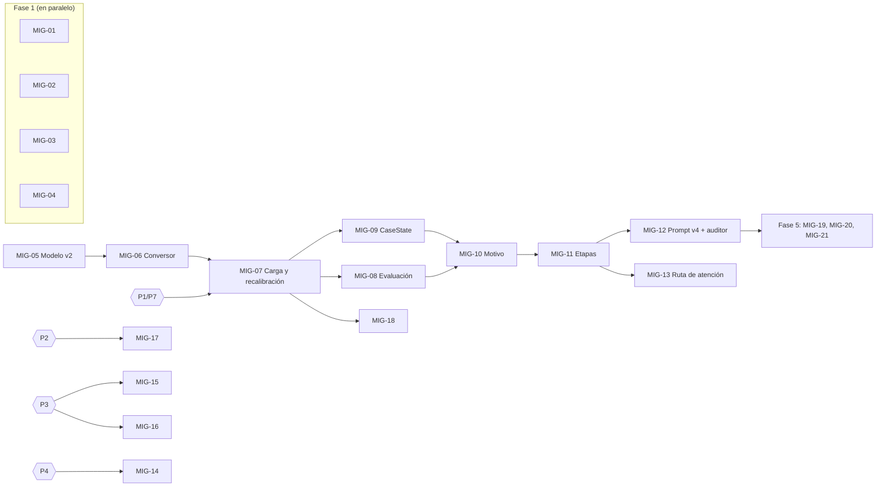

# Plan de migración: base RAG v2 y correcciones de arquitectura

- **Estado:** propuesta para discusión del equipo (no aprobada)
- **Fecha:** 2026-10-22
- **Rama:** `docs/plan-migracion-rag2` (desde `main` @ `57e23d8`)
- **Insumos:** `RAG_2.xlsx` (base nueva), [propuesta de correcciones de arquitectura](anexos/arquitectura-correcciones-propuesta.md) (anexo, cambios #1–#24) y `sugerencias teleorientacion.docx` (destino de cada archivo y orden sugerido).

---

## 1. Propósito y cómo usar este plan

Este documento **no es una especificación de implementación**. Es una guía para cortar historias de usuario y especificaciones pequeñas que lleven el proyecto actual a:

1. Usar la base de conocimiento v2 (2.304 registros por cuadros y etapas).
2. Dejar de escalar a urgencias con demasiada facilidad.
3. Dejar de descartar consultas (fuera de alcance o abstención).
4. Indagar de verdad antes de orientar.

Convenciones:

- Cada paquete de trabajo lleva un ID provisional **`MIG-xx`**. No se usan IDs `HU-10…` porque ya existe la rama `feat/hu-10-auditoria-multicanal`. El equipo asigna los IDs definitivos al convertir cada paquete en HU.
- Los cambios del anexo se citan como **#1…#24**.
- Las decisiones que AGENTS.md §5 reserva al equipo (contenido clínico, umbrales de alarma, arquitectura, riesgos éticos) aparecen como **puertas `P1…P7`** (§6). Un paquete que depende de una puerta no se implementa hasta que el equipo decida y lo registre en un ADR.
- Al convertir un paquete en HU sí aplican todas las reglas del proyecto: especificación primero, pruebas, matriz de impacto, CHANGELOG y bitácora IA.

---

## 2. Análisis de la base RAG v2 (`RAG_2.xlsx`)

Cifras medidas con un script de solo lectura sobre el Excel.

### 2.1 Estructura

| Aspecto | Valor |
|---|---|
| Hojas | `CARDIOVASCULAR` (1.152 filas) y `MATERNO-INFANTIL` (1.152 filas) |
| Registros | **2.304** (la base actual tiene 1.600) |
| Columnas | 14: Categoría, Enfoque, Preguntas, Respuestas, Motivo, Etapa, Ruta, Lectura clínica, Datos a extraer, Señales de escalamiento, Ruta base del cuadro, Fuente, Validado por, Fecha validación |
| Categorías | 16 (8 por dominio, 144 registros cada una) |
| Cuadros (`Motivo`) | **192** (12 por categoría). Ningún motivo se repite entre dominios |
| Registros por cuadro | **12**, exactamente uno por etapa |
| Duplicados | 0 preguntas y 0 respuestas repetidas |

### 2.2 Enfoque, etapa y ruta

Cada cuadro tiene la misma secuencia de 12 etapas. La relación Enfoque → Etapa → Ruta es fija:

| Enfoque | Etapa | Ruta | Función |
|---|---|---|---|
| Indagar | `T1_discriminantes` | indagacion | Preguntas que separan lo grave-ahora de lo no grave |
| Indagar | `T2_caracterizacion` | indagacion | Cómo es el síntoma |
| Indagar | `T3_contexto` | indagacion | Antecedentes y entorno |
| Orientar | `accion_inmediata` | autocuidado | Qué hacer ahora mismo |
| Orientar | `vigilancia` | seguimiento | Qué señales obligan a escalar |
| Orientar | `evolucion_leve` | autocuidado | Qué hacer si ya cedió |
| Remitir | `consulta_prioritaria` | consulta_prioritaria | Dónde, en cuánto tiempo, qué llevar |
| Remitir | `traslado_urgencias` | urgencias | Cómo trasladarse y qué hacer en el camino |
| Remitir | `seguimiento_tras_atencion` | seguimiento | Qué sigue después de la atención |
| Acompañar | `verificacion_del_cuadro` | indagacion | Devuelve el cuadro entendido para que la persona lo confirme |
| Acompañar | `apoyo_en_espera` | seguimiento | Acompañamiento mientras espera la atención |
| Acompañar | `apoyo_emocional` | seguimiento | Contención del miedo o el cansancio |

### 2.3 Campos del cuadro

`Lectura clínica`, `Datos a extraer`, `Señales de escalamiento`, `Ruta base del cuadro` y `Categoría` son **constantes dentro de cada motivo** (se repiten 12 veces; 0 inconsistencias). Conviene normalizarlos en una tabla aparte de 192 cuadros.

- **Datos a extraer:** 6–7 datos por cuadro, separados por `|` (p. ej., "edad en meses | horario y duración del llanto | …"). Son texto libre, no códigos.
- **Señales de escalamiento:** 3 por cuadro, en lenguaje coloquial.
- **Ruta base del cuadro:** consulta_prioritaria en 80 cuadros, autocuidado en 63 y urgencias en 49.

### 2.4 Contenido

- **Respuestas:** 441–448 caracteres de media, máximo 520 (cabe en `item_max_chars` = 700). Unas 5 oraciones por respuesta.
- **Las 2.304 respuestas terminan en pregunta.** Las de T1–T3 traen unas 3,9 preguntas cada una. Las demás traen 1 (verificacion_del_cuadro, 1,7).
- **Preguntas:** habla real (jerga, mala ortografía, mensajes vagos o largos). Muchas son **respuestas a la pregunta anterior** del asistente ("no, dolor no tengo…"). 110 tienen menos de 35 caracteres y dependen del contexto ("¿qué hago ya?").
- **Fuente, Validado por y Fecha validación están vacías en los 2.304 registros.** La base no cumple aún AGENTS.md §4 (fuentes citadas y validadas) ni cierra B-019.

### 2.5 Discrepancias con la propuesta del anexo

Hay que corregirlas antes de usar el anexo como referencia:

| El anexo dice | El Excel tiene |
|---|---|
| 1.920 registros, 10 por cuadro | **2.304 registros, 12 por cuadro** |
| Etapa `T4_verificacion` (Indagar) | `verificacion_del_cuadro`, con enfoque **Acompañar** y ruta indagacion |
| 10 etapas | 3 etapas más: `seguimiento_tras_atencion`, `apoyo_en_espera`, `apoyo_emocional` |
| 767 de 768 registros Indagar sin lenguaje de remisión | **39 de 576** respuestas Indagar mencionan hospital, urgencias o 123, sobre todo en T1 de cuadros urgentes ("se atiende en un hospital ahora mismo"). Es clínicamente razonable, pero invalida el argumento de que con el filtro por etapa el primer turno "no puede" terminar en urgencias |
| Se entregan `entries.jsonl` y `rag_xlsx_a_jsonl.py` (según el docx) | **No se recibieron.** Hay que escribir el conversor |

### 2.6 Hallazgo de diseño principal

Con 12 registros por cuadro, uno por etapa, **dentro de un motivo elegir el registro es un problema de estado (en qué etapa va la conversación), no de similitud**. La búsqueda por similitud queda para dos cosas:

1. **Identificar el motivo** en el primer turno (o cuando cambia el tema).
2. **Detectar saltos de intención** dentro del motivo: "ya nos atendieron" → `seguimiento_tras_atencion`; "¿qué hago ya?" → `accion_inmediata`; "me da miedo" → `apoyo_emocional`.

Esto también resuelve el problema de las preguntas cortas: "no, desde ayer" no se puede recuperar bien sola entre 2.304 registros, pero sí dentro de los 12 del motivo fijado.

### 2.7 Uso propuesto de las columnas nuevas

| Columna | Uso propuesto | Restricción |
|---|---|---|
| Motivo, Etapa, Ruta, Enfoque | Filtros de la recuperación y estado del caso | — |
| Lectura clínica | Auditoría (panel web, traza) | **Nunca** al usuario ni a la llamada de respuesta: es lenguaje diagnóstico ("Sugiere cólico del lactante") y el servicio no diagnostica |
| Datos a extraer | Datos pendientes del estado del caso (`CaseState`) | Texto libre; normalizar en una fase posterior |
| Señales de escalamiento | Candidatas a `examples` del catálogo de alarmas y prueba de cobertura | Solo con revisión clínica (AGENTS.md §4–§5). No alimentan alarmas automáticamente |
| Ruta base del cuadro | Fuente determinista para la ruta de atención (HU-05, B-006) | Siempre subordinada a las alarmas deterministas (ADR 0004) |
| Preguntas | **Conjunto de evaluación etiquetado** (2.304 mensajes con motivo y etapa) para medir la recuperación y el filtro 1 | — |
| Fuente / Validado por / Fecha | Trazabilidad clínica por registro (B-019) | Hoy vacías → puerta P1 |

---

## 3. Impacto en el código actual

| Punto | Situación actual | Qué hay que cambiar |
|---|---|---|
| `domain/knowledge.py` → `Focus` | Solo `Indagar` / `Solucionar` | Cuatro valores (`Indagar`, `Orientar`, `Remitir`, `Acompañar`). Sin esto **la carga falla** en el primer registro "Orientar" |
| `KnowledgeEntry` | `id, domain, category, focus, question, answer` | Agregar `motive`, `stage`, `route`. Los datos del cuadro van en una entidad aparte (`CaseProfile`) |
| `adapters/outbound/rag/knowledge_files.py::parse_entry` | Claves fijas | Leer las claves nuevas; validar enumeraciones |
| `id` de los registros | Hash del piloto | El Excel no trae `id`. Proponer un **id determinista** a partir de `(dominio, motivo, etapa)`, que es único y se mantiene si se edita el texto |
| `hybrid_retriever.check_compatibility` | Compara solo el conjunto de ids | Con ids estables, editar un texto no avisaría que hay que reconstruir el índice. Comparar también `entries_sha256`, que ya se guarda en el manifiesto (`kb_index_builder.py:59`) |
| `KnowledgeEntry.embedding_text` | Pregunta + respuesta | Evaluar con el conjunto de §2.7 si conviene solo la pregunta, o ambas |
| `HybridRetriever._allowed_ids` | Filtra solo por dominio | Filtrar también por motivo y etapa |
| `knowledge/evidence_policy.json` | `min_similarity` 0,50, calibrado con la base vieja | Recalibrar con la base v2 |
| Pruebas | `tests/unit/fakes.py:179` y `test_rag_components.py` usan `Focus.SOLVE`; `tests/live/test_live_rag.py` espera categorías (las de MI cambiaron de nombre) | Actualizar |
| `scripts/export_pilot_kb.py` | Exporta desde el piloto | Queda obsoleto. Nuevo conversor `scripts/convert_rag_xlsx.py` (biblioteca estándar; implementado en MIG-06) |
| `knowledge/kb/README.md` | Describe 1.600 registros `VALIDADA_PARA_PROTOTIPO` | Reescribir con la base v2 y su estado de validación (P1) |

---

## 4. Verificación de las causas raíz del anexo contra el código (`57e23d8`)

| Causa | Veredicto | Evidencia |
|---|---|---|
| U1 Las frases de remisión siempre pasan el verificador | ✅ Confirmada | `domain/grounding.py:104-106`: se restan `REFERRAL_WORDS`; si no queda nada, devuelve 1.0 |
| U2 Si una frase falla, se muestra el registro completo | ✅ Confirmada | `application/grounded_reply.py:75-78`. Con la base v2 monofuncional el literal ya no arrastra avisos de otro tema |
| U3 `system_prompt_v5.md` ordena mandar a urgencias | ❌ **No aplica** | Ese prompt no se carga: `bootstrap/main.py:45-46` usa `analysis_prompt_v6.md` y `reply_prompt_v3.md` |
| U4 La regla se activa con el nombre del signo y el prompt pide escribirlo | ✅ Confirmada | `domain/alarms.py:74` + `prompts/analysis_prompt_v6.md:18`. Es el "puente de nombres canónicos" documentado en ADR 0007 (act. 2) |
| U5 Sin negaciones ni atribución de persona | ✅ Confirmada, pero es **decisión explícita** | ADR 0007, punto 7 ("criterio conservador") |
| U6 Con urgencia inmediata solo se muestra el mensaje fijo | ✅ Confirmada | `application/alarm_policy.py:150-151` |
| D1 La respuesta a una contrapregunta puede quedar fuera de alcance | ✅ Confirmada | `application/scope.py:35`. El prompt v6 ya lo pide, pero no hay respaldo determinista |
| D2 Fuera de alcance no se registra | ✅ Confirmada | `conversation_service.py:274` y `_finish` (`:367`); probado en `tests/unit/test_web_app.py:65` |
| D3 La abstención no pregunta | ✅ Confirmada | `grounded_reply.py:22-25` |
| D4 La búsqueda se limita al dominio del análisis | ✅ Confirmada | `application/evidence.py:68-69` |
| D5 `num_ctx` 4096 trunca el prompt | ⚠️ Plausible, sin medir | `.env.example:30`. Medir `prompt_eval_count` antes de decidir |
| I1 No hay estado de indagación | ✅ Confirmada | `domain/conversation.py`: el hilo solo guarda `summary` |
| I2 Máximo 2 frases sin cita | ✅ Confirmada | `evidence_policy.json` y `reply_prompt_v3.md:17`. Con la base v2 las preguntas están en los registros y se pueden citar |
| I3 El corpus Indagar está escrito como meta-pregunta | ✅ Confirmada en la base vieja | Lo resuelve la base v2 |
| I4 `Focus` no dirige la recuperación | ✅ Confirmada | `domain/knowledge.py:12-16` |
| I5 Un solo prompt de análisis con 7 campos | ✅ Confirmada | `analysis_prompt_v6.md` |
| I6 Todo es secuencial y el dispatcher tiene un trabajador | ✅ Confirmada, por diseño | ADR 0014: Ollama atiende una solicitud a la vez |

---

## 5. Viabilidad de los cambios propuestos

Leyenda: ✅ Viable · 🔧 Viable con ajustes · 🚪 Requiere decisión del equipo · ⏸️ Diferido · ❌ No recomendado · ➖ No aplica

| # | Cambio | Veredicto | Motivo | Paquete |
|---|---|---|---|---|
| 1 | Quitar la resta de `REFERRAL_WORDS` | 🔧 | Correcto quitarla. La lista blanca sobra: el LLM no redacta los mensajes fijos de alarma, los compone `compose_reply`. Enmienda ADR 0010 | MIG-04 |
| 2 | Si una frase falla, mostrar solo la primera oración | ❌ | La primera oración suele ser la empatía ("Gracias por contarme") y se pierden las preguntas. Con la base v2 y el filtro por etapa, el literal completo de un registro es seguro y útil | — |
| 3 | Urgencia = mensaje fijo + acción + pregunta de estado | 🚪 | Bueno, pero el texto agregado debe salir de datos validados (catálogo ampliado o el registro `traslado_urgencias` del motivo), nunca del LLM. Puerta P4 | MIG-14 |
| 4 | Quitar la activación por nombre del signo | 🚪 | Hay que medir antes cuánto recall del filtro 2 se pierde (ronda del benchmark). Enmienda ADR 0007/0012 y prompt de análisis. Puerta P3 | MIG-15 |
| 5 | Ventana de negación y de tercera persona | 🚪 / ❌ parcial | Contradice ADR 0007. **Tercera persona: no recomendado**: el servicio atiende a quien consulta por otra persona ("mi hermana embarazada está sangrando" debe alarmar). **Negación:** proponer que **degrade, no suprima** (de urgencia a indagación T1 con pregunta discriminante). Puerta P2 | MIG-17 |
| 6 | Borrar la instrucción de urgencias de `system_prompt_v5` | ➖ | El prompt no se carga. Opcional: marcar los prompts obsoletos en `docs/05-ia/prompts/README.md` | — |
| 7 | Agente A3 con evidencia textual obligatoria | 🔧 / 🚪 | Sin agente nuevo: agregar `evidence_span` por código al esquema actual y verificar la subcadena de forma determinista (normalizada, en el mensaje o el hilo). Qué hacer si falla (descartar o degradar) es decisión del equipo porque afecta el recall de alarmas. Puerta P3 | MIG-16 |
| 8 | Respuesta a contrapregunta siempre en alcance | ✅ | Alto impacto y bajo riesgo: regla determinista en `scope.py` con `TurnInput.recent` | MIG-01 |
| 9 | Registrar el turno fuera de alcance | 🔧 | Registrar en el hilo activo si existe; sin hilo, no abrir uno. Cambia criterios de HU-07 | MIG-02 |
| 10 | No filtrar por dominio hasta confirmarlo | ✅ | Más simple con la base v2: buscar en ambos dominios hasta fijar el motivo (los motivos no se cruzan) | MIG-10 |
| 11 | Abstención + contrapregunta + acción segura | ✅ | Plantilla fija, sin afirmaciones de salud | MIG-03 |
| 12 | Umbral adaptativo | 🔧 | Primero recalibrar con la base v2. El reintento con umbral menor solo debe admitir registros Indagar | MIG-07, MIG-11 |
| 13 | `num_ctx` 8192 | 🚪 | En la RTX de 8 GB el modelo de 24B ya se reparte entre GPU y CPU (turno p50 ≈ 46–50 s). Medir primero. Enmienda ADR 0011. Puerta P6 | MIG-21 |
| 14 | `CaseState` | ✅ | Central. MVP: `{motivo, dominio, etapa, turnos_indagacion, ruta, pregunta_pendiente}`; datos pendientes en una segunda iteración. Requiere ADR | MIG-09 |
| 15 | Máquina de estados con mínimo de datos antes de orientar | 🔧 | La regla debe ceder ante la intención explícita ("¿qué hago ya?"), que la base v2 modela en `accion_inmediata` | MIG-11 |
| 16 | Prompt v4 con 2–3 contrapreguntas | 🔧 | Más pequeño: las preguntas ya están en los registros T1–T3 y se pueden citar. No hace falta subir `max_free_sentences` | MIG-12 |
| 17 | Dividir el análisis en tres agentes | ❌ con el hardware actual | Tres llamadas en una GPU de 8 GB se serializan (Ollama atiende una a la vez) y multiplican la latencia del análisis. Alternativa: identificar el motivo por recuperación (CPU, determinista) y simplificar el esquema actual. Puerta P6 | MIG-10, MIG-21 |
| 18 | Orquestador en paralelo | ⏸️ | Para el LLM, misma razón que #17. Solo es viable la multi-consulta de embeddings en CPU | MIG-21 |
| 19 | Dispatcher con varios trabajadores | ⏸️ | Sin ganancia mientras Ollama serialice. Retomar con Telegram o con otro hardware | MIG-21 |
| 20 | Auditor de salida determinista | ✅ | Con la base v2 basta comprobar que la respuesta termina en pregunta y, si no, anexar la pregunta final del registro citado (está en el registro, luego está respaldada) | MIG-12 |
| 21 | Seguimiento programado tras alarma | 🚪 | Mensajes no solicitados (riesgo ético) y dependencia de HU-01 (consentimiento). Los temporizadores en memoria se pierden al reiniciar. Solo WhatsApp. Puerta P5 | MIG-19 |
| 22 | `Focus` de 4 valores + etapa | ✅ **Obligatorio** | Sin esto la base v2 no carga | MIG-05 |
| 23 | Conjuntos de evaluación | ✅ | Ampliar con el conjunto de Preguntas (precisión de motivo y etapa) | MIG-08 |
| 24 | Métricas en el tablero | ✅ | Baja prioridad; el panel de HU-08 ya tiene la traza | MIG-20 |

**Sobre el orden "mínimo para mañana" del docx** (#1, #2, #3, #8, #9, #11 + base + reindexar): se recomienda **#1, #8, #9, #11** como primer paso. #2 no se recomienda, #3 espera la puerta P4 y la base no puede entrar antes de #22 (MIG-05).

---

## 6. Puertas de decisión del equipo

| Puerta | Decisión | Bloquea |
|---|---|---|
| **P1** | Estado de validación de la base v2 (Fuente/Validado por/Fecha vacías). ¿Se repite la decisión `VALIDADA_PARA_PROTOTIPO`? ¿Quién valida y con qué plazo? | MIG-07 |
| **P2** | ¿La negación puede degradar una alarma? ¿Con qué palabras y ventana? | MIG-17 |
| **P3** | Retiro del puente de nombres de signo y política de `evidence_span` (descartar o degradar) | MIG-15, MIG-16 |
| **P4** | Contenido del mensaje de urgencia enriquecido (acción para el momento y pregunta de estado) | MIG-14 |
| **P5** | ¿Se permiten mensajes de seguimiento proactivos tras una alarma? | MIG-19 |
| **P6** | `num_ctx` y agentes en paralelo según el hardware disponible | MIG-21 |
| **P7** | ¿Se reemplaza la base vieja o conviven durante la evaluación? (Recomendación: reemplazar en `main` y conservar la vieja en una etiqueta de git para comparar) | MIG-07 |

---

## 7. Fases y paquetes de trabajo

Cada paquete es candidato a una HU o especificación pequeña. Los criterios son borradores para refinar en `docs/01-especificacion/`.

### Fase 1: correcciones acotadas, sin tocar la base

Paquetes independientes entre sí. Resuelven buena parte de los descartes sin cambiar la arquitectura.

> **Estado (2026-10-22):** MIG-01 a MIG-04 implementados en la rama `fix/fase1-descarte-y-abstencion` (pruebas automáticas en verde). Falta `pytest -m live` en el PC de pruebas y la aprobación de los textos fijos nuevos.

#### MIG-01 Una respuesta a una contrapregunta nunca queda fuera de alcance (#8)
- **Código:** `application/scope.py` (`effective_scope` recibe los mensajes recientes), `application/conversation_service.py`.
- **Documentos:** HU-07, ADR 0009, `flujo-conversacional.md`, `trazabilidad.md`.
- **Criterios (borrador):**
  - Dado un hilo cuyo último mensaje del asistente termina en "?", cuando la persona responde "sí" o "desde ayer", entonces el turno es `en_alcance`.
  - Dado un hilo sin pregunta pendiente, cuando la persona escribe "¿quién ganó el partido?", entonces el turno sigue siendo `fuera_de_alcance`.
- **Riesgo:** bajo.

#### MIG-02 El turno fuera de alcance se registra y reengancha (#9)
- **Código:** `conversation_service._route` y `_finish`, `scope.OUT_OF_SCOPE_MESSAGE` (terminar en pregunta abierta).
- **Documentos:** HU-07 (cambia el criterio "no se registra"), `tests/unit/test_web_app.py:65`, `modelo-datos.md`.
- **Criterios:** con hilo activo, el turno fuera de alcance queda en ese hilo; sin hilo, no se abre uno.
- **Riesgo:** bajo.

#### MIG-03 Abstención que pregunta (#11)
- **Código:** `application/grounded_reply.py` (`ABSTENTION_TEXT` como plantilla), uso en `_answer`.
- **Documentos:** HU-02, ADR 0010.
- **Criterios:** sin evidencia suficiente no se llama al LLM, y la respuesta fija termina con una pregunta que pide más detalles, sin afirmaciones de salud.
- **Riesgo:** bajo.

#### MIG-04 El verificador no exime las frases de remisión (#1)
- **Código:** `domain/grounding.py` (`support_ratio`, `is_supported`).
- **Documentos:** ADR 0010 (enmienda), `estrategia-pruebas.md`.
- **Criterios:** una frase citada compuesta solo de palabras de remisión se rechaza si el registro citado no las contiene.
- **Riesgo:** medio: puede aumentar los textos literales. Medir con `pytest -m live` (`test_live_grounding.py`).

### Fase 2: integración de la base v2 (orden estricto)

> **Estado (2026-10-22):** MIG-05 y MIG-06 implementados en la rama `feat/mig-05-06-base-rag2` ([ADR 0016](../02-arquitectura/adr/0016-base-de-conocimiento-v2-por-cuadros-y-etapas.md), propuesto). La conversión real de `RAG_2.xlsx` da 2.304 registros y 192 cuadros sin errores. MIG-07 espera las puertas P1 y P7.

#### MIG-05 Modelo de datos de la base v2 (#22)
- **Código:** `domain/knowledge.py` (`Focus` de 4 valores, enumeraciones `Stage` y `Route`, campos `motive`, `stage`, `route`; entidad `CaseProfile` con lectura clínica, datos a extraer, señales y ruta base), `knowledge_files.py`, `tests/unit/fakes.py`, `test_rag_components.py`.
- **Datos:** `knowledge/kb/entries.jsonl` (2.304) + `knowledge/kb/cuadros.jsonl` (192).
- **Documentos:** ADR nuevo "Base de conocimiento v2 por cuadros y etapas" (enmienda ADR 0008), `docs/04-datos/modelo-datos.md`, `diccionario-datos.md`.
- **Criterios:** la carga rechaza combinaciones Enfoque/Etapa/Ruta que no estén en la tabla de §2.2.

#### MIG-06 Conversor Excel → JSONL
- **Código:** `scripts/convert_rag_xlsx.py` y `scripts/xlsx_reader.py`; `hybrid_retriever.check_entries_file` compara `entries_sha256`.
- **Validaciones del conversor:** 12 etapas por motivo, coherencia Enfoque/Etapa/Ruta, campos del cuadro constantes por motivo, sin celdas vacías obligatorias, longitudes máximas, ids únicos. Emite un informe con conteos.
- **Documentos:** `knowledge/kb/README.md` (nuevo procedimiento), `docs/08-despliegue/operacion.md`.

#### MIG-07 Carga, reindexado y recalibración
- **Pasos:** generar los JSONL, reconstruir el índice (`run_build_kb_index.py`), recalibrar `evidence_policy.json` (v2.0.0) con el conjunto de Preguntas, actualizar `tests/live/test_live_rag.py`.
- **Puertas:** P1 y P7.
- **Documentos:** `knowledge/kb/README.md` (estado de validación), CHANGELOG, `riesgos-ia.md`.

#### MIG-08 Conjuntos de evaluación (#23)
- **Pruebas en `tests/live/` (marcador `live`):**
  - `descarte_indebido`: respuestas cortas a contrapreguntas.
  - `urgencia_falsa`: negaciones (para medir, antes de decidir P2).
  - `profundidad_indagacion`: preguntas por conversación antes de orientar.
  - Precisión de motivo top-1/top-3 y de etapa usando la columna Preguntas.
- **Pruebas sin Ollama:** el filtro 1 sobre las Preguntas de cuadros con ruta base urgencias (cobertura) y de cuadros de autocuidado (falsos positivos).
- **Documentos:** `estrategia-pruebas.md`.

### Fase 3: estado del caso y recuperación dirigida por etapa

#### MIG-09 `CaseState` persistido en el hilo (#14)
- **Código:** `domain/case_state.py`, adaptadores JSON y SQLite, `ThreadRepository`, `tests/unit/test_thread_repository_contract.py`.
- **Documentos:** ADR nuevo "Estado del caso" (extiende ADR 0006 y 0015), HU-06, `modelo-datos.md`.
- **Criterios:** el estado sobrevive entre turnos y reinicios en los dos adaptadores; nunca guarda datos personales.

#### MIG-10 Identificación del motivo por recuperación (#10; alternativa a #17)
- **Idea:** el motivo se elige por votación de los mejores registros recuperados (en ambos dominios mientras no esté fijado) y queda fijado en el `CaseState`. Un cambio de tema detectado por el análisis (`thread_action = nuevo`) lo libera.
- **Código:** `application/evidence.py`, `hybrid_retriever.py`.
- **Documentos:** ADR 0008 (enmienda), HU-02.
- **Criterios:** precisión de motivo medida con MIG-08 por encima de un umbral que decide el equipo.

#### MIG-11 Máquina de etapas y filtro por etapa (#15, #12)
- **Idea:** progresión por defecto T1 → T2 → T3 → `verificacion_del_cuadro` → Orientar/Remitir según la ruta base. La intención explícita salta etapas (detectada por similitud dentro del motivo). Las alarmas deterministas siempre tienen prioridad.
- **Código:** nuevo módulo de aplicación para la transición de etapas; `HybridRetriever._allowed_ids` filtra por motivo y etapa.
- **Documentos:** HU-02, HU-05, `flujo-conversacional.md`, BPMN si cambia el flujo.

#### MIG-12 Prompt de respuesta v4 y auditor de salida (#16, #20)
- **Código:** `prompts/reply_prompt_v4.md` (citar también las preguntas del registro), `application/output_audit.py`.
- **Documentos:** `docs/05-ia/prompts/README.md`, ADR 0010.
- **Criterios:** toda respuesta con evidencia termina en una pregunta respaldada por el registro citado.

#### MIG-13 Ruta de atención desde el cuadro (HU-05, B-006)
- **Idea:** la ruta base del cuadro decide Orientar o Remitir cuando no hay alarma; nunca rebaja una alarma.
- **Documentos:** HU-05, ADR 0004.

### Fase 4: ajustes del filtro de alarmas (cada uno tras su puerta)

| Paquete | Cambio | Puerta | Documentos |
|---|---|---|---|
| MIG-14 | Mensaje de urgencia que acompaña y pregunta (#3) | P4 | ADR 0007, `alarm_rules.json` (`messages`), HU-03/HU-04 |
| MIG-15 | Retiro del puente de nombres de signo (#4), con ronda del benchmark | P3 | ADR 0007/0012, prompt de análisis v7 |
| MIG-16 | `evidence_span` para cada código de signo (#7) | P3 | ADR 0012, `analysis_schema` |
| MIG-17 | Negación que degrada, no suprime (#5), con ≥ 2 frases por regla en `alarm_phrases.json` | P2 | ADR 0007, `solicitud-validacion-alarmas.md` |
| MIG-18 | Cobertura: cuadros con ruta base urgencias frente a reglas del catálogo; señales de escalamiento como ejemplos candidatos | Revisión clínica | `alarm_rules.json`, ADR 0007 |

### Fase 5: acompañamiento y operación (diferidos)

| Paquete | Cambio | Puerta |
|---|---|---|
| MIG-19 | Seguimiento programado tras una alarma con `ThreadingDelayedActions` y registros `apoyo_en_espera` (#21) | P5, HU-01 |
| MIG-20 | Métricas en el panel web: % de turnos con contrapregunta, urgencias por filtro, abstenciones, profundidad de indagación (#24) | — |
| MIG-21 | `num_ctx`, multi-consulta en CPU y paralelismo según hardware (#13, #17–#19) | P6 |

---

## 8. Mapa de dependencias

---

## 9. Documentos que tocará la migración

- **Especificación:** HU-02, HU-05, HU-06 y HU-07 en `historias-usuario.md`, `especificacion-ejecutable.md` y `trazabilidad.md`.
- **ADR:** enmiendas a 0006, 0007, 0008, 0009, 0010, 0011 y 0012; dos ADR nuevos (base de conocimiento v2; estado del caso).
- **Arquitectura y procesos:** `arquitectura.md`, `flujo-conversacional.md`, BPMN de gestión de alerta (si cambia el mensaje de urgencia).
- **Datos:** `modelo-datos.md`, `diccionario-datos.md`, `knowledge/kb/README.md`.
- **IA y calidad:** `docs/05-ia/prompts/README.md`, `riesgos-ia.md`, `estrategia-pruebas.md`.
- **Gestión:** `backlog.md` (ítems nuevos por cada MIG aprobado), `pendientes-aprobacion.md` (puertas P1–P7).
- **AGENTS.md §1:** agregar el estado del caso y la base por etapas; la regla de las dos llamadas (ADR 0008) sigue vigente.

---

## 10. Riesgos de la migración

| Riesgo | Mitigación |
|---|---|
| La base v2 no tiene fuente ni validación clínica por registro | Puerta P1 antes de usarla con personas reales |
| Pérdida de recall de alarmas al retirar el puente o al tratar negaciones | Medir con el benchmark y con MIG-08 antes de decidir; degradar en lugar de suprimir |
| Lenguaje diagnóstico de "Lectura clínica" llega al usuario | No enviarla nunca a la llamada de respuesta; prueba que lo verifique |
| Más latencia (num_ctx, más llamadas) | Medir antes; preferir decisiones deterministas en CPU |
| Regresión de las sondas en vivo por el cambio de categorías y umbral | Actualizar `tests/live` en MIG-07 |
| Que el filtro por etapa oculte un aviso necesario | Las alarmas deterministas siempre van primero; la etapa solo elige la evidencia |
