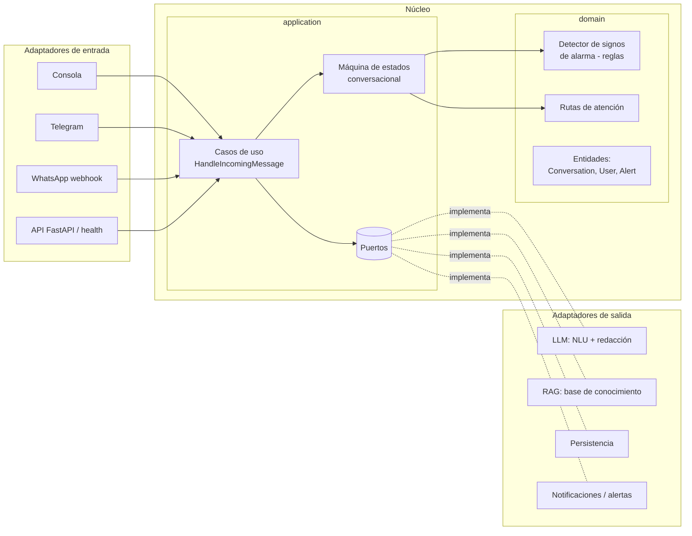
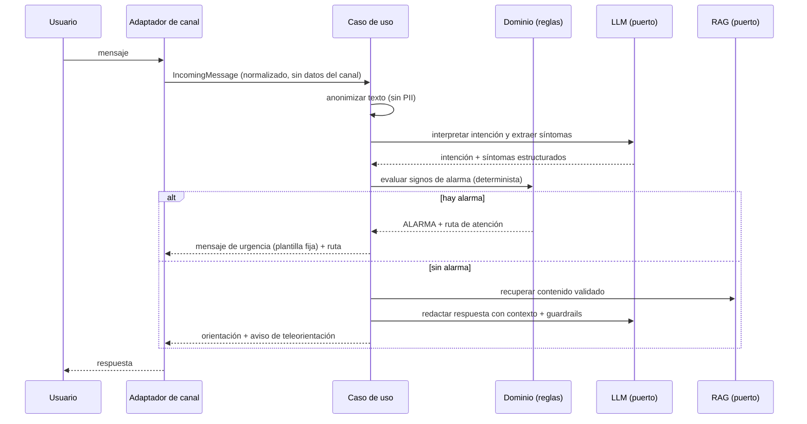
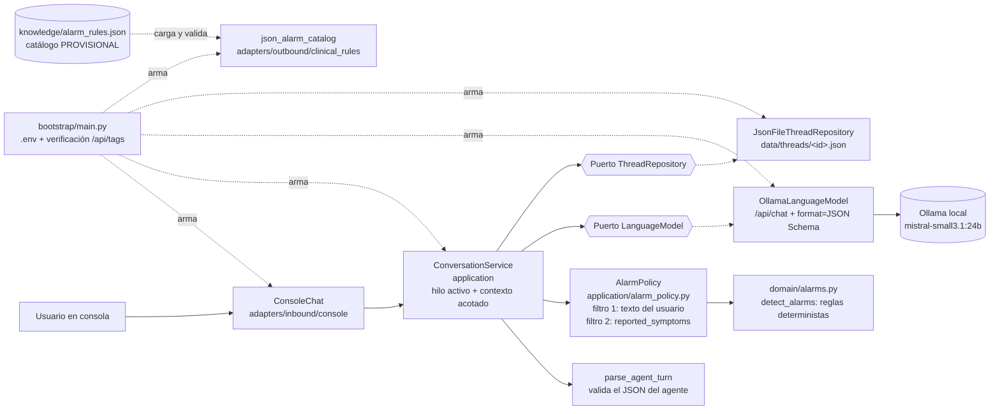
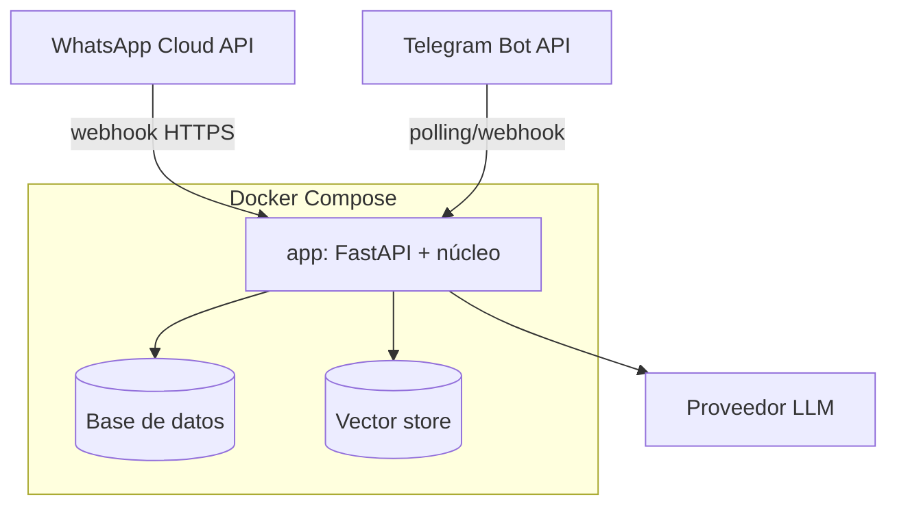

# Documento de arquitectura

*Última actualización: 2026-10-10*

## 1. Patrón arquitectónico
**Arquitectura hexagonal (puertos y adaptadores) en un monolito modular.** Justificación en [ADR 0001](adr/0001-arquitectura-hexagonal.md).

El núcleo (dominio + aplicación) no conoce el canal ni el proveedor de LLM. Así se puede:
- probar el flujo completo por **consola**, y luego conectar **Telegram** y **WhatsApp** sin tocar el núcleo ([ADR 0003](adr/0003-canales-progresivos.md));
- cambiar de proveedor de LLM o de base de datos cambiando solo un adaptador;
- mantener las reglas clínicas aisladas, deterministas y 100 % testeables ([ADR 0004](adr/0004-reglas-deterministas-vs-llm.md)).

## 2. Diagrama de componentes

## 3. Flujo de datos de un mensaje

## 4. Puertos y adaptadores
| Puerto | Responsabilidad | Adaptadores |
|---|---|---|
| `MessageChannel` | Enviar respuestas al usuario | console, telegram, whatsapp |
| `LanguageModel` (`application/ports/language_model.py`) | Generar la respuesta estructurada del agente (`complete_json` con JSON Schema) | ✅ `OllamaLanguageModel` (`adapters/outbound/llm/`, [ADR 0005](adr/0005-ollama-local-como-llm.md)) |
| `KnowledgeRetriever` | Recuperar contenido validado | TODO: vector store (ADR pendiente) |
| `ThreadRepository` (`application/ports/thread_repository.py`) | Persistir hilos y mensajes (con `thread_id`) | ✅ `JsonFileThreadRepository` (`adapters/outbound/persistence/`, [ADR 0006](adr/0006-hilos-conversacionales-con-resumen.md)); TODO: BD para Telegram |
| `AlertNotifier` | Notificar alertas al equipo de salud | TODO (hoy las alertas solo se registran en el hilo vía `ThreadRepository.append_alert`) |

## 4.1 Estado implementado (HU-00 + HU-06 + HU-03/04, prototipo técnico)
Camino actual: consola → `ConversationService` (alarmas deterministas con doble filtro + hilos) → Ollama con salida JSON. Las reglas de alarma son PROVISIONALES (R-09).

- Contrato del agente (`application/agent_turn.py`): `{thread_action: continuar|nuevo, domain, summary, reply, reported_symptoms}`.
- Alarmas ([ADR 0007](adr/0007-alarmas-deterministas-doble-filtro.md), [flujo](../03-procesos/flujos/gestion-alerta.md)): el filtro 1 corre antes del LLM (si hay urgencia inmediata, el LLM no se consulta) y el filtro 2 sobre `reported_symptoms`. Las alertas se guardan en el hilo con su origen.
- Contexto por turno: prompt v2 + JSON del hilo actual + últimos `THREAD_CONTEXT_MESSAGES` mensajes del hilo + mensaje nuevo. Ver el [flujo](../03-procesos/flujos/flujo-conversacional.md).
- El prompt de sistema está versionado en `src/cardio_materno/prompts/system_prompt_v4.md` (`reported_symptoms` literal y completo). Los síntomas del agente se registran en cada respuesta del asistente.
- Los errores de Ollama o un JSON inválido se traducen a `LanguageModelError`. En ese caso no se guarda nada y la consola sigue funcionando.

## 5. Stack
Python 3.12+, FastAPI, pytest, ruff, mypy. Justificación en [ADR 0002](adr/0002-python-fastapi.md). LLM: Ollama local ([ADR 0005](adr/0005-ollama-local-como-llm.md)). El chat de consola no tiene dependencias de ejecución (solo librería estándar). Vector store y base de datos: pendientes de ADR.

## 6. Diagrama de despliegue (objetivo)

TODO: definir el entorno de pruebas (servidor, HTTPS, dominio).
