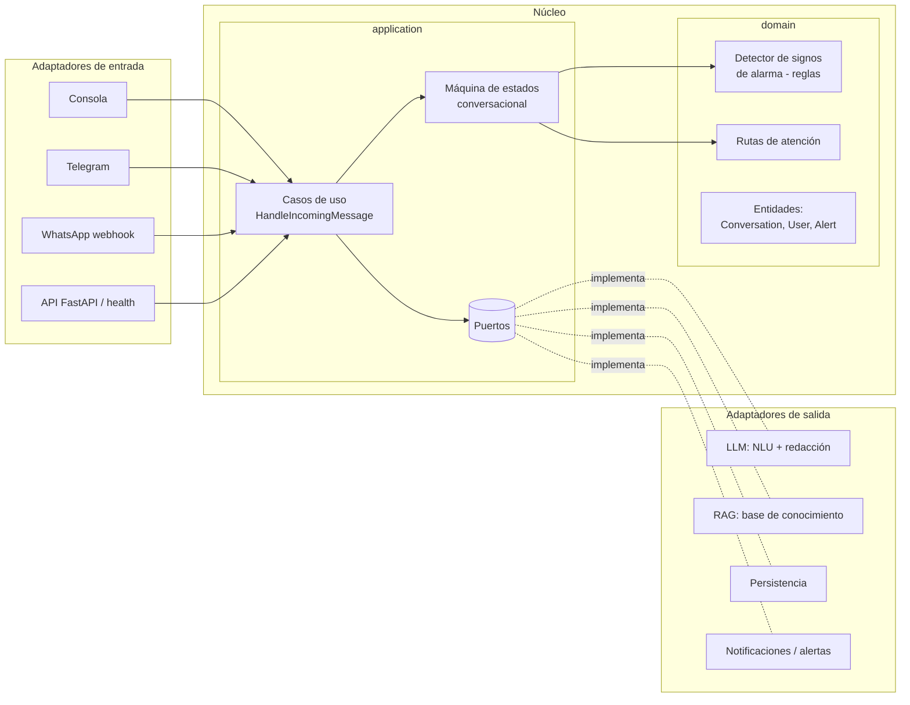
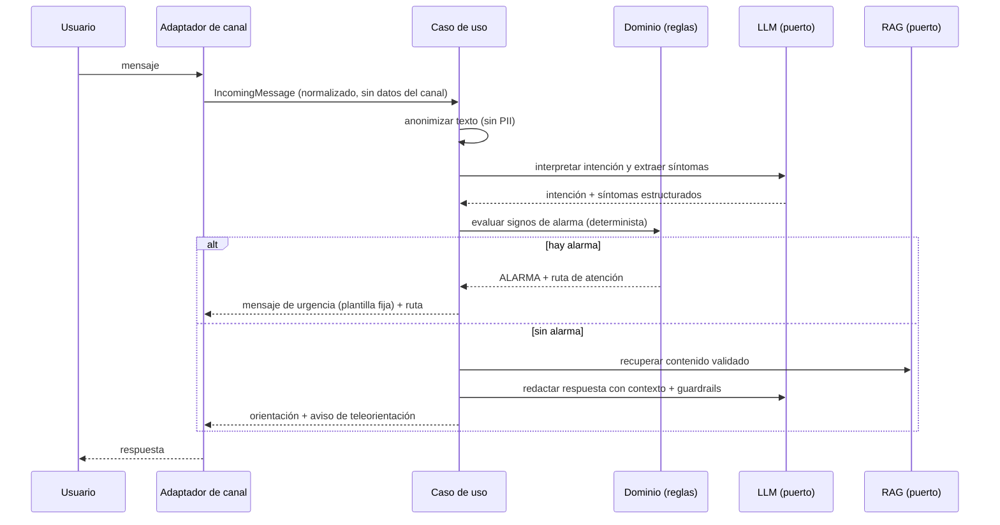
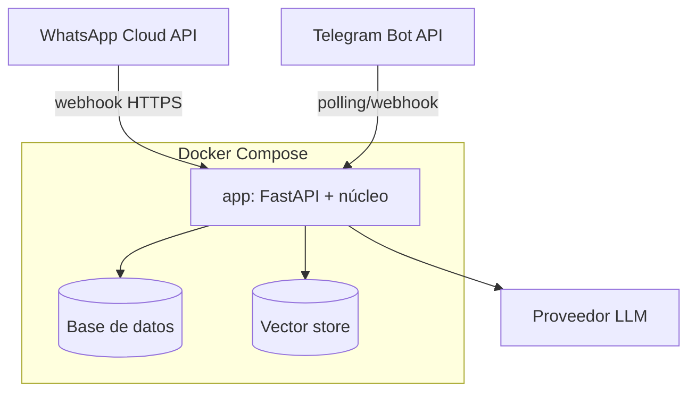

# Documento de arquitectura

*Última actualización: 2026-10-09*

## 1. Patrón arquitectónico
**Arquitectura hexagonal (puertos y adaptadores) en un monolito modular.** Justificación en [ADR 0001](adr/0001-arquitectura-hexagonal.md).

El núcleo (dominio + aplicación) no conoce el canal ni el proveedor de LLM. Así se puede:
- probar el flujo completo por **consola**, y luego conectar **Telegram** y **WhatsApp** sin tocar el núcleo ([ADR 0003](adr/0003-canales-progresivos.md));
- cambiar de proveedor de LLM o de base de datos cambiando solo un adaptador;
- mantener las reglas clínicas aisladas, deterministas y 100 % testeables ([ADR 0004](adr/0004-reglas-deterministas-vs-llm.md)).

## 2. Diagrama de componentes

## 3. Flujo de datos de un mensaje

## 4. Puertos previstos (borrador)
| Puerto | Responsabilidad | Adaptadores |
|---|---|---|
| `MessageChannel` | Enviar respuestas al usuario | console, telegram, whatsapp |
| `LanguageModel` | Interpretar intención y redactar | TODO: proveedor (ADR pendiente) |
| `KnowledgeRetriever` | Recuperar contenido validado | TODO: vector store (ADR pendiente) |
| `ConversationRepository` | Persistir el estado de la conversación | memoria (consola), TODO: BD |
| `AlertNotifier` | Registrar o notificar alertas | log (inicial), TODO |

## 5. Stack
Python 3.12+, FastAPI, pytest, ruff, mypy. Justificación en [ADR 0002](adr/0002-python-fastapi.md). LLM, vector store y base de datos: pendientes de ADR.

## 6. Diagrama de despliegue (objetivo)

TODO: definir el entorno de pruebas (servidor, HTTPS, dominio).
