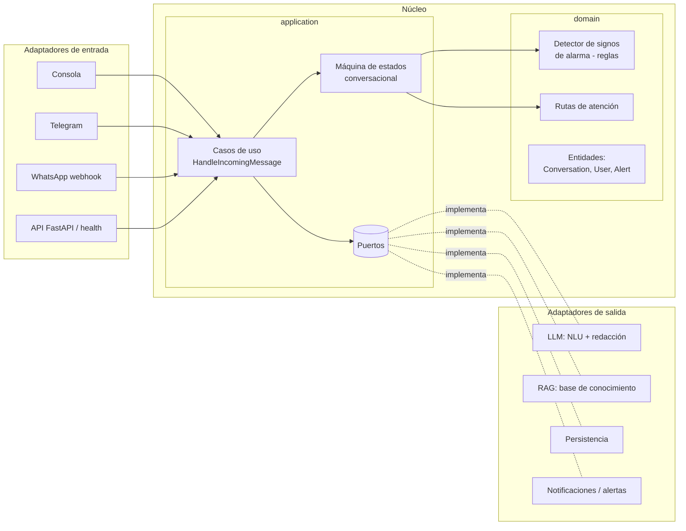
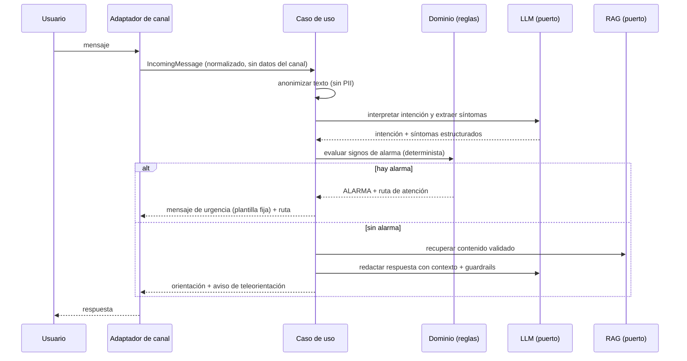
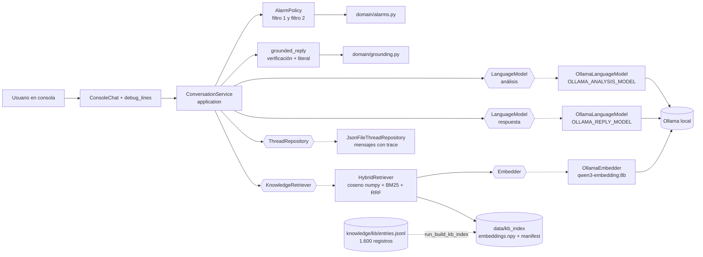
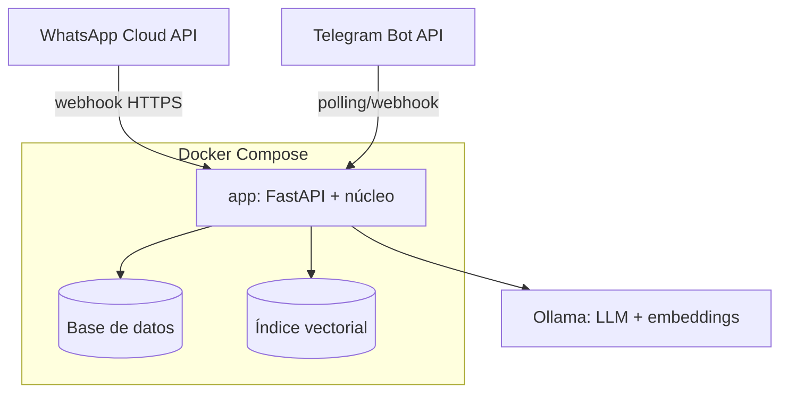

# Documento de arquitectura

*Última actualización: 2026-10-10*

## 1. Patrón arquitectónico
**Arquitectura hexagonal (puertos y adaptadores) en un monolito modular.** Justificación en [ADR 0001](adr/0001-arquitectura-hexagonal.md).

El núcleo (dominio + aplicación) no conoce el canal ni el proveedor de LLM. Así se puede:
- probar el flujo completo por **consola**, y luego conectar **Telegram** y **WhatsApp** sin tocar el núcleo ([ADR 0003](adr/0003-canales-progresivos.md));
- cambiar de proveedor de LLM o de base de datos cambiando solo un adaptador;
- mantener las reglas clínicas aisladas, deterministas y 100 % testeables ([ADR 0004](adr/0004-reglas-deterministas-vs-llm.md)).

## 2. Diagrama de componentes

## 3. Flujo de datos de un mensaje

## 4. Puertos y adaptadores
| Puerto | Responsabilidad | Adaptadores |
|---|---|---|
| `MessageChannel` | Enviar respuestas al usuario | console, telegram, whatsapp |
| `LanguageModel` (`application/ports/language_model.py`) | Generar la respuesta estructurada del agente (`complete_json` con JSON Schema) | ✅ `OllamaLanguageModel` (`adapters/outbound/llm/`, [ADR 0005](adr/0005-ollama-local-como-llm.md)) |
| `KnowledgeRetriever` (`application/ports/knowledge_retriever.py`) | Recuperar evidencia de la base | ✅ `HybridRetriever` (`adapters/outbound/rag/`, [ADR 0008](adr/0008-rag-evidencia-y-dos-llamadas.md)); `UnavailableRetriever` si no hay índice |
| `Embedder` (`application/ports/embedder.py`) | Convertir textos en vectores | ✅ `OllamaEmbedder` (`/api/embed`, `qwen3-embedding:8b`) |
| `ThreadRepository` (`application/ports/thread_repository.py`) | Persistir hilos y mensajes (con `thread_id`) | ✅ `JsonFileThreadRepository` (`adapters/outbound/persistence/`, [ADR 0006](adr/0006-hilos-conversacionales-con-resumen.md)); TODO: BD para Telegram |
| `AlertNotifier` | Notificar alertas al equipo de salud | TODO (hoy las alertas solo se registran en el hilo vía `ThreadRepository.append_alert`) |

## 4.1 Estado implementado (HU-00, HU-06, HU-03/04, HU-02; prototipo técnico)
Camino actual: consola → `ConversationService` → filtro 1 → **llamada de análisis (sin evidencia)** → filtro 2 → **RAG** → **llamada de respuesta (con evidencia)** → **verificación determinista del respaldo**. Sin evidencia suficiente no hay llamada de respuesta (abstención fija). Reglas de alarma PROVISIONALES (R-09).

- **Contratos** (`application/agent_turn.py`): análisis `{thread_action, domain, summary, reported_symptoms}`; respuesta con evidencia `{sentences: [{text, evidence_id}]}`, con `evidence_id` restringido por `enum` a las etiquetas ofrecidas o `"ninguna"`; respuesta conversacional `{reply, evidence_ids: []}`.
- **Respaldo** ([ADR 0010](adr/0010-respuesta-verificada-y-abstencion-determinista.md), `application/grounded_reply.py` + `domain/grounding.py`): sin evidencia suficiente, `ABSTENTION_TEXT` sin llamar al LLM; con evidencia, cada frase citada debe estar respaldada por su registro (palabras con contenido ≥ `min_support` y todos los números); si una falla, se muestra el texto literal del registro.
- **Contexto:** `application/turn_context.py`. El análisis recibe prompt + JSON del hilo + últimos N mensajes; la respuesta recibe prompt + caso analizado + últimos N mensajes + EVIDENCIA. La evidencia nunca entra al análisis (ADR 0008).
- **Alarmas** ([ADR 0007](adr/0007-alarmas-deterministas-doble-filtro.md)): con urgencia en el filtro 1, no hay llamadas ni RAG; con urgencia en el filtro 2, no hay RAG ni llamada de respuesta.
- **Alcance** ([ADR 0009](adr/0009-control-de-alcance-por-intencion.md), `application/scope.py`): sin alarma, `fuera_de_alcance` da un mensaje fijo, sin RAG ni respuesta y sin registro; `conversacional` da respuesta sin RAG. Las alarmas y los síntomas reportados de nuestros dominios nunca se descartan.
- **Latencia:** `OLLAMA_KEEP_ALIVE` y `OLLAMA_EMBED_NUM_GPU` (embedder en CPU) son configurables; ver el diagnóstico en [operacion.md](../08-despliegue/operacion.md).
- **Prompts:** `prompts/analysis_prompt_v2.md` (con `{{SIGNOS_DE_ALARMA}}`) y `prompts/reply_prompt_v3.md`.
- **Traza:** cada respuesta guarda `trace` (síntomas, evidencia, citas, estado de la búsqueda, tiempos y verificación del respaldo `grounding`). Ver el [diccionario de datos](../04-datos/diccionario-datos.md).
- **Errores:** `LanguageModelError` si fallan el análisis o la respuesta. Sin alarma no se guarda nada; con alarma, se muestra el mensaje fijo. Si el RAG no está disponible, se muestra la abstención fija.

## 5. Stack
Python 3.12+, FastAPI (previsto), pytest, ruff, mypy. LLM: Ollama local ([ADR 0005](adr/0005-ollama-local-como-llm.md)). RAG: índice propio con **numpy** ([ADR 0008](adr/0008-rag-evidencia-y-dos-llamadas.md)); `numpy` es la única dependencia de ejecución (`requirements.txt`).

## 6. Diagrama de despliegue (objetivo)

TODO: definir el entorno de pruebas (servidor, HTTPS, dominio).
