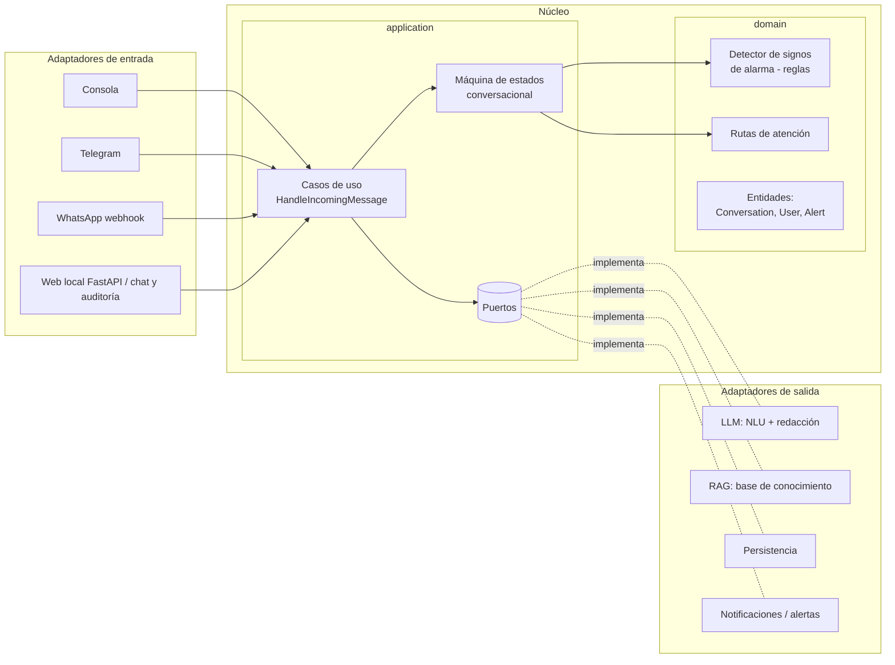
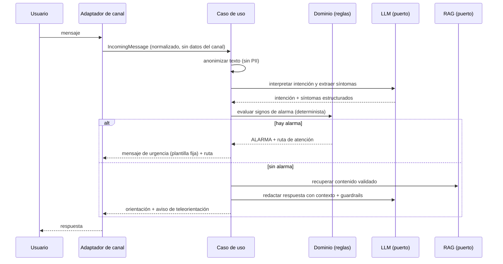
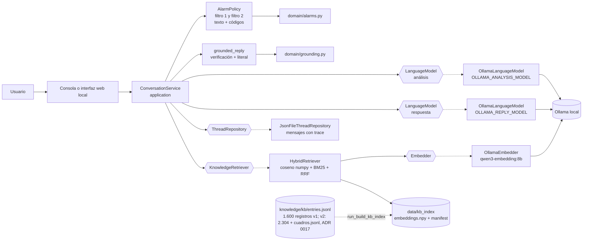
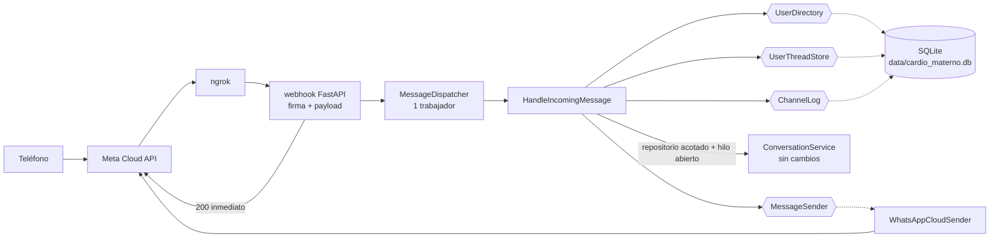
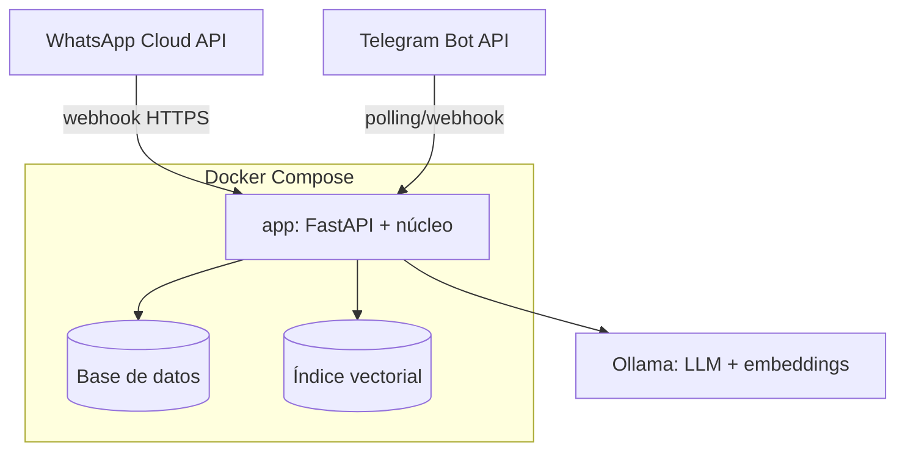

# Documento de arquitectura

*Última actualización: 2026-10-12 (HU-08)*

## 1. Patrón arquitectónico
**Arquitectura hexagonal (puertos y adaptadores) en un monolito modular.** Justificación en [ADR 0001](adr/0001-arquitectura-hexagonal.md).

El núcleo (dominio + aplicación) no conoce el canal ni el proveedor de LLM. Así se puede:
- probar el flujo completo por **consola**, y luego conectar **Telegram** y **WhatsApp** sin tocar el núcleo ([ADR 0003](adr/0003-canales-progresivos.md));
- cambiar de proveedor de LLM o de base de datos cambiando solo un adaptador;
- mantener las reglas clínicas aisladas, deterministas y 100 % testeables ([ADR 0004](adr/0004-reglas-deterministas-vs-llm.md)).

## 2. Diagrama de componentes

## 3. Flujo de datos de un mensaje

## 4. Puertos y adaptadores
| Puerto | Responsabilidad | Adaptadores |
|---|---|---|
| `MessageSender` (`application/ports/message_sender.py`, antes "MessageChannel") | Enviar respuestas, avisos e indicador de lectura por el canal | ✅ `WhatsAppCloudSender` (`adapters/outbound/whatsapp/`, [ADR 0014](adr/0014-canal-whatsapp-cloud-api.md)); la consola y la web responden directamente |
| `DelayedActions` (mismo archivo) | Programar el aviso de espera | ✅ `ThreadingDelayedActions` (`adapters/inbound/whatsapp/dispatcher.py`) |
| `LanguageModel` (`application/ports/language_model.py`) | Generar la respuesta estructurada del agente (`complete_json` con JSON Schema) | ✅ `OllamaLanguageModel` (`adapters/outbound/llm/`, [ADR 0005](adr/0005-ollama-local-como-llm.md)) |
| `KnowledgeRetriever` (`application/ports/knowledge_retriever.py`) | Recuperar evidencia de la base | ✅ `HybridRetriever` (`adapters/outbound/rag/`, [ADR 0008](adr/0008-rag-evidencia-y-dos-llamadas.md)); `UnavailableRetriever` si no hay índice |
| `Embedder` (`application/ports/embedder.py`) | Convertir textos en vectores | ✅ `OllamaEmbedder` (`/api/embed`, `qwen3-embedding:8b`) |
| `ThreadRepository` (`application/ports/thread_repository.py`) | Persistir hilos y mensajes (con `thread_id`) | ✅ `JsonFileThreadRepository` (`adapters/outbound/persistence/`, [ADR 0006](adr/0006-hilos-conversacionales-con-resumen.md)) para consola y web; ✅ `SqliteThreadRepository`, acotado a un usuario ([ADR 0015](adr/0015-persistencia-sqlite-y-usuarios.md)). Los dos cumplen el mismo contrato (`test_thread_repository_contract.py`) |
| `UserThreadStore` (`application/ports/user_thread_store.py`) | Hilo abierto de cada usuario (con su última actividad) y su repositorio acotado | ✅ `SqliteUserThreadStore` (ADR 0015) |
| `UserDirectory` (`application/ports/user_directory.py`) | Usuarios y su identidad seudonimizada por canal | ✅ `SqliteUserDirectory` (ADR 0015) |
| `ChatAudit` (`application/ports/chat_audit.py`) | Leer los chats de todos los canales para auditarlos: lista por canal, páginas por *keyset* sobre `seq`, alertas por turno y mensajes en proceso | ✅ `SqliteChatAudit` ([ADR 0016](adr/0016-auditoria-multicanal-y-chats-por-usuario.md)) |
| `ChannelLog` (`application/ports/channel_log.py`) | Deduplicar mensajes del canal y auditar lo recibido y enviado, sin texto | ✅ `SqliteChannelLog` (ADR 0014 y 0015) |
| `AlertNotifier` | Notificar alertas al equipo de salud | TODO (hoy las alertas solo se registran en el hilo vía `ThreadRepository.append_alert`) |

## 4.1 Estado implementado (HU-00, HU-06, HU-03/04, HU-02, HU-08; prototipo técnico)
El flujo puede entrar por consola o por la interfaz web local y comparte `ConversationService` → filtro 1 → **llamada de análisis (sin evidencia)** → filtro 2 → **RAG** → **llamada de respuesta (con evidencia)** → **verificación determinista del respaldo**. Sin evidencia suficiente no hay llamada de respuesta (abstención fija). Reglas de alarma PROVISIONALES (R-09).

- **Interfaz local (HU-08, HU-10):** se inicia con `python run_web.py` (`bootstrap/web.py`). `WEB_HOST` solo admite loopback (`load_web_settings`).
  - **Desde la HU-10** lee y escribe en la base SQLite de todos los canales: `DirectChat` para escribir y `SqliteChatAudit` para leer.
  - La API está en `adapters/inbound/api/web_app.py` y el contrato JSON en `serializers.py`:

    | Ruta | Uso |
    |---|---|
    | `GET /api/config` | Tamaño de página, frecuencia de actualización y canales |
    | `GET /api/chats` | Lista de chats, con filtro `channel` y `limit`/`offset` |
    | `POST /api/chats` | Nueva sesión: crea un chat web |
    | `GET /api/chats/{id}` | Resumen del chat, `writable` y motivo del bloqueo |
    | `GET /api/chats/{id}/messages` | `before` para las páginas anteriores, `after` para lo nuevo; incluye `pending` |
    | `POST /api/chats/{id}/messages` | 403 en WhatsApp, Telegram, histórico o consola abierta; 409 si ya hay un turno en curso en ese chat |
    | `POST /api/chats/{id}/release` | Libera un chat de consola que quedó marcado |

  - Los `entry_id` de la traza se resuelven contra la base de conocimiento para mostrar la pregunta y la respuesta completas.
  - La consola (`bootstrap/console.py`) también usa SQLite: un chat por arranque, bloqueado para la web mientras está abierta.
- **Hilos por usuario (HU-09, fase 2, [ADR 0015](adr/0015-persistencia-sqlite-y-usuarios.md)):** para los canales de chat continuo se crea un `ConversationService` por mensaje con `ports.repository = UserThreadStore.scoped(user_id)` y `active_thread_id` = hilo abierto del usuario. El agente recibe el mismo contexto que en la consola (`test_conversation_per_user.py` lo compara llamada por llamada) y no puede ver hilos de otra persona. Base SQLite: `sqlite_database.py` (esquema versionado, transacciones). La usa el canal de WhatsApp (siguiente punto).
- **Chats por usuario en todos los canales (HU-10, [ADR 0016](adr/0016-auditoria-multicanal-y-chats-por-usuario.md), en implementación):**
  - `application/user_conversations.py::UserConversations`: cierra el hilo inactivo y crea el `ConversationService` del usuario. Lo comparten WhatsApp (`HandleIncomingMessage`), la consola y la web.
  - `application/direct_chat.py::DirectChat`: chats de consola y web. Hace cumplir la regla `domain/user.py::chat_lock` (WhatsApp, Telegram e histórico son de solo lectura; un chat abierto en una consola queda bloqueado para la web). `ConsoleChatSession` le da a la consola la misma interfaz que antes.
  - `application/import_history.py` (`run_import_history.py`): importa los hilos JSON anteriores a un chat `historico`.
  - Fábrica común en `bootstrap/conversation_factory.py`.
- **Canal WhatsApp (HU-09, fase 3, [ADR 0014](adr/0014-canal-whatsapp-cloud-api.md)):** `python run_whatsapp.py` (`bootstrap/whatsapp.py`) sirve el webhook en loopback y ngrok lo publica. El flujo es: webhook (`adapters/inbound/whatsapp/webhook.py`: verificación, firma, `payload.py` → `IncomingMessage`) → 200 inmediato → `MessageDispatcher` (cola de un trabajador) → `HandleIncomingMessage` (`application/`). Este último resuelve el usuario, deduplica, acusa recibo, cierra el hilo inactivo, crea el `ConversationService` del usuario, programa el aviso de espera, divide la respuesta y la envía por `MessageSender` → `WhatsAppCloudSender` (Graph API).

- **Contratos** (`application/agent_turn.py`): análisis `{thread_action, domain, summary, reported_symptoms, search_query, scope, scope_reason}`; respuesta con evidencia `{sentences: [{text, evidence_id}]}`, con `evidence_id` restringido por `enum` a las etiquetas ofrecidas o `"ninguna"`; respuesta conversacional `{reply, evidence_ids: []}`.
- **Evidencia por etapas** ([ADR 0018](adr/0018-estado-del-caso-y-evidencia-por-etapas.md), propuesto; solo con la base v2 del [ADR 0017](adr/0017-base-de-conocimiento-v2-por-cuadros-y-etapas.md)): `application/case_flow.py` identifica el cuadro por recuperación y elige la etapa con las reglas deterministas de `domain/case_state.py`; el estado del caso viaja en la traza de cada respuesta (sin cambios de esquema). `application/output_audit.py` asegura que la respuesta termine en la pregunta del registro.
- **Respaldo** ([ADR 0010](adr/0010-respuesta-verificada-y-abstencion-determinista.md), `application/grounded_reply.py` + `domain/grounding.py`): sin evidencia suficiente, `ABSTENTION_TEXT` (que pide más detalles) o `UNAVAILABLE_TEXT` sin llamar al LLM; con evidencia, cada frase citada debe estar respaldada por su registro (palabras con contenido ≥ `min_support` y todos los números); si una falla, se muestra el texto literal del registro.
- **Contexto:** `application/turn_context.py`. El análisis recibe prompt + JSON del hilo + últimos N mensajes; la respuesta recibe prompt + caso analizado + últimos N mensajes + EVIDENCIA. La evidencia nunca entra al análisis (ADR 0008).
- **Alarmas** ([ADR 0007](adr/0007-alarmas-deterministas-doble-filtro.md)): con urgencia en el filtro 1, no hay llamadas ni RAG; con urgencia en el filtro 2, no hay RAG ni llamada de respuesta. Desde el [ADR 0012](adr/0012-signos-reportados-como-codigos-cerrados.md) (provisional), el filtro 2 revisa los síntomas en texto **y** cruza de forma exacta los códigos de `reported_signs` (`AlarmPolicy.evaluate_codes`, `domain/alarms.py::rules_for_codes`); el esquema del análisis se arma con los códigos del catálogo.
- **Alcance** ([ADR 0009](adr/0009-control-de-alcance-por-intencion.md), `application/scope.py`): sin alarma, `fuera_de_alcance` da un mensaje fijo, sin RAG ni respuesta y sin registro; `conversacional` da respuesta sin RAG. Las alarmas y los síntomas reportados de nuestros dominios nunca se descartan.
- **Configuración:** todo lo ajustable vive en `.env`, ordenado por secciones (`.env.example`). Cada etapa tiene su modelo, temperatura, contexto, tiempo de espera, razonamiento y límite de tokens (`bootstrap/settings.py::load_stage_settings`, `stage_environment`). Los umbrales del RAG y de la verificación de `.env` se aplican sobre `evidence_policy.json` (`rag_setup.py::load_effective_policy`).
- **Latencia** ([ADR 0011](adr/0011-modelos-por-etapa-y-latencia.md), decidido de momento: análisis mistral-small, respuesta qwen3): embedder en CPU por defecto (`OLLAMA_EMBED_NUM_GPU=0`), `OLLAMA_KEEP_ALIVE`, precalentamiento de los modelos al arrancar (`warm_up`), límite de tokens por etapa (`OLLAMA_*_NUM_PREDICT`) y `OLLAMA_THINK`; comparación de modelos con `scripts/benchmark_models.py`. Ver [operacion.md](../08-despliegue/operacion.md).
- **Consulta de búsqueda:** `search_query` del análisis, sin el contexto ajeno; si viene vacía, mensaje + resumen + síntomas (`application/evidence.py::build_evidence_query`). Queda en la traza.
- **Datos no dichos:** `domain/grounding.py::unstated_details` marca en la traza los síntomas con números que la persona no escribió (auditoría; el filtro 2 los sigue revisando).
- **Prompts:** `prompts/analysis_prompt_v3.md` (con `{{SIGNOS_DE_ALARMA}}`) y `prompts/reply_prompt_v3.md`.
- **Traza:** cada respuesta guarda `trace` (síntomas, evidencia, citas, estado de la búsqueda, tiempos y verificación del respaldo `grounding`). Ver el [diccionario de datos](../04-datos/diccionario-datos.md).
- **Errores:** `LanguageModelError` si fallan el análisis o la respuesta. Sin alarma no se guarda nada; con alarma, se muestra el mensaje fijo. Si el RAG no está disponible, se muestra la abstención fija.

## 5. Stack
Python 3.12+, FastAPI, Uvicorn, pytest, ruff, mypy. LLM: Ollama local ([ADR 0005](adr/0005-ollama-local-como-llm.md)). RAG: índice propio con **numpy** ([ADR 0008](adr/0008-rag-evidencia-y-dos-llamadas.md)). FastAPI y Uvicorn son dependencias de ejecución para HU-08 ([ADR 0013](adr/0013-interfaz-web-local-de-auditoria.md)).

## 6. Diagrama de despliegue (objetivo)

TODO: definir el entorno de pruebas (servidor, HTTPS, dominio).
