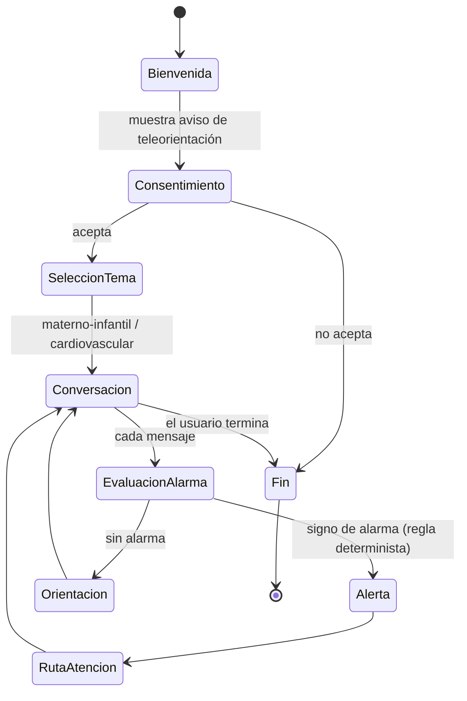

# Flujo conversacional general (borrador)

*Última actualización: 2026-10-09*

Este flujo corresponde a la máquina de estados que se implementará en `application/`. Cualquier cambio en los estados o las transiciones debe reflejarse aquí **y** en el BPMN (`../bpmn/`).

TODO: detallar los subflujos por tema (embarazo, posparto, recién nacido, menor de 5 años, riesgo cardiovascular).
