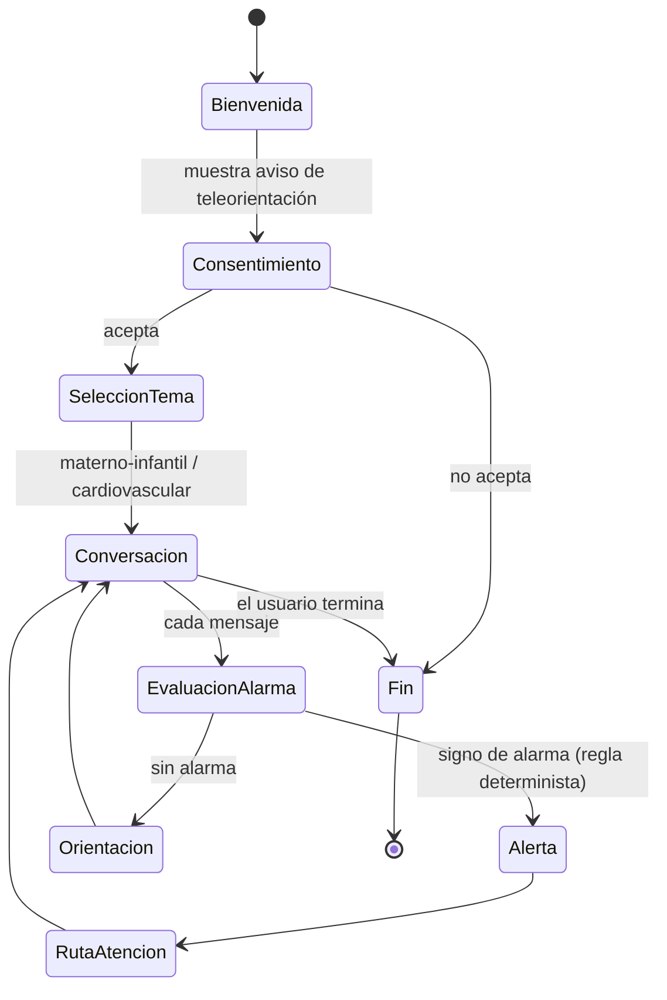
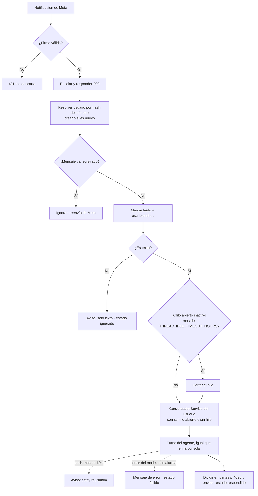

# Flujo conversacional general (borrador)

*Última actualización: 2026-10-11*

Este flujo corresponde a la máquina de estados que se implementará en `application/`. Cualquier cambio en los estados o las transiciones debe reflejarse aquí **y** en el BPMN (`../bpmn/`).



TODO: detallar los subflujos por tema (embarazo, posparto, recién nacido, menor de 5 años, riesgo cardiovascular).

## Turno implementado (HU-06 + HU-03/04 + HU-02; ADR 0006, 0007, 0008)
Este es el comportamiento **actual** del prototipo. El diagrama de estados de arriba es el objetivo e incluye etapas que aún no existen, como el consentimiento.

```mermaid
sequenceDiagram
    participant U as Usuario
    participant S as ConversationService
    participant A as Reglas de alarma
    participant L1 as Agente · análisis
    participant K as RAG (KnowledgeRetriever)
    participant L2 as Agente · respuesta
    participant R as ThreadRepository (JSON)
    U->>S: mensaje
    S->>A: filtro 1 (texto original)
    alt urgencia inmediata
        S-->>U: mensaje fijo 🚨 (sin LLM, sin RAG)
    else prioritaria o ninguna
        S->>L1: prompt de análisis + JSON del hilo + últimos N mensajes + mensaje (SIN evidencia)
        L1-->>S: {thread_action, domain, summary, reported_symptoms, reported_signs, search_query, scope, scope_reason}
        S->>A: filtro 2 (cada síntoma de reported_symptoms + códigos de reported_signs)
        alt urgencia inmediata
            S-->>U: mensaje fijo 🚨 (sin RAG, sin llamada 2)
        else sin alarma y scope = fuera_de_alcance (todo el mensaje es ajeno)
            S-->>U: mensaje fijo de alcance (sin RAG, sin llamada 2, NO se registra)
        else sin alarma y scope = conversacional (saludo, gracias)
            S->>L2: prompt de respuesta + MENSAJE CONVERSACIONAL (sin RAG)
            L2-->>S: {reply}
            S-->>U: saludo / presentación del servicio (nunca abre un hilo; sin hilo activo NO se registra)
        else en alcance (o con alarma prioritaria)
            S->>K: consulta = search_query (o mensaje + resumen + síntomas si viene vacía), en el dominio del análisis
            K-->>S: evidencia [E1..E3] o insuficiente / no disponible
            alt insuficiente o no disponible
                S-->>U: abstención fija (o solo el mensaje ⚠️ si hay prioritaria), SIN llamada 2
            else suficiente
                S->>L2: prompt de respuesta + caso + últimos N mensajes + EVIDENCIA + mensaje
                L2-->>S: {sentences: [{text, evidence_id ∈ ofrecidas ∪ "ninguna"}]}
                S->>S: verificación determinista (domain/grounding.py); si una frase citada no está respaldada → texto literal del registro
                S-->>U: (mensaje fijo ⚠️ si prioritaria) + respuesta verificada
            end
        end
    end
    S->>R: actualizar o abrir hilo · mensajes con thread_id y trace · alertas (una urgencia de otro dominio abre un hilo de su dominio)
    Note over U,S: "salir" → se cierra el hilo activo
```

## Chat continuo por WhatsApp (HU-09; ADR 0014 y 0015)
En WhatsApp no hay sesiones: cada persona tiene un solo chat, y en él los hilos se abren y se cierran. El turno del agente es **el mismo** de la sección anterior; antes y después se agregan los pasos propios del canal.



- **Un hilo abierto por persona.** Dentro del chat, el análisis decide `continuar` o `nuevo`, como en la consola. Además, la inactividad cierra el hilo, lo que equivale a escribir "salir".
- **Sin mezcla de personas:** el agente solo ve el hilo de quien escribió (repositorio acotado por usuario).
- **Orden:** una cola con un trabajador procesa los mensajes en orden de llegada.
