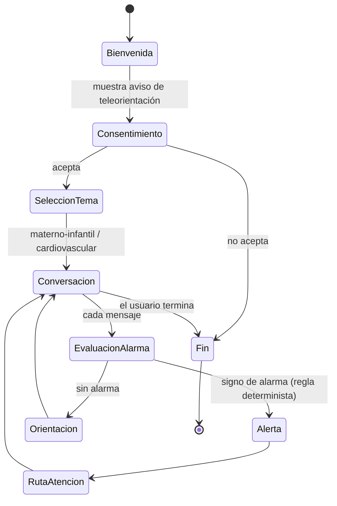
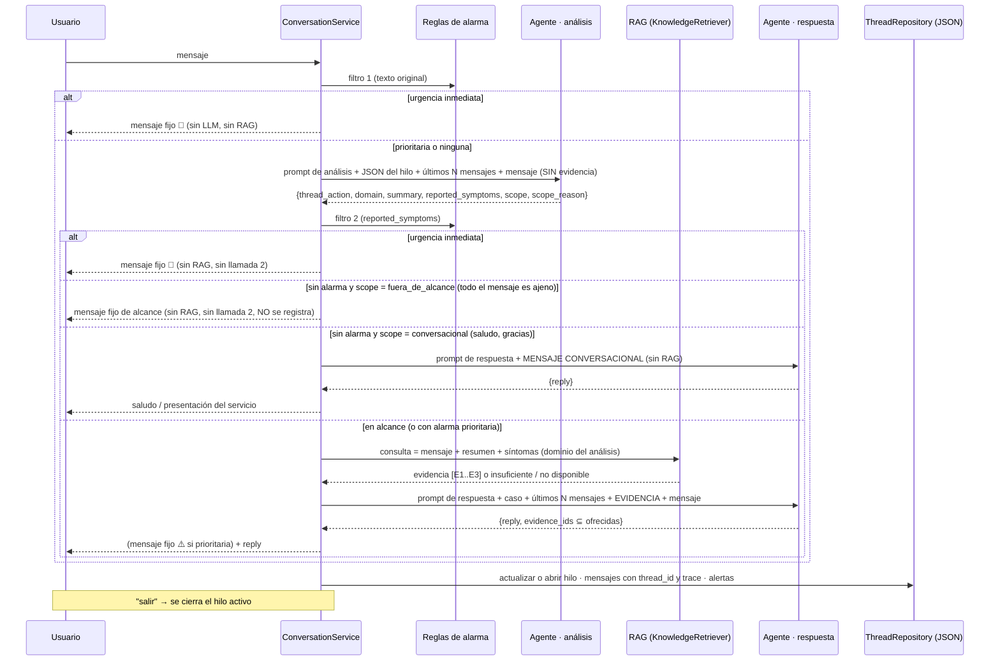

# Flujo conversacional general (borrador)

*Última actualización: 2026-10-10*

Este flujo corresponde a la máquina de estados que se implementará en `application/`. Cualquier cambio en los estados o las transiciones debe reflejarse aquí **y** en el BPMN (`../bpmn/`).

TODO: detallar los subflujos por tema (embarazo, posparto, recién nacido, menor de 5 años, riesgo cardiovascular).

## Turno implementado (HU-06 + HU-03/04 + HU-02; ADR 0006, 0007, 0008)
Este es el comportamiento **actual** del prototipo. El diagrama de estados de arriba es el objetivo e incluye etapas que aún no existen, como el consentimiento.

