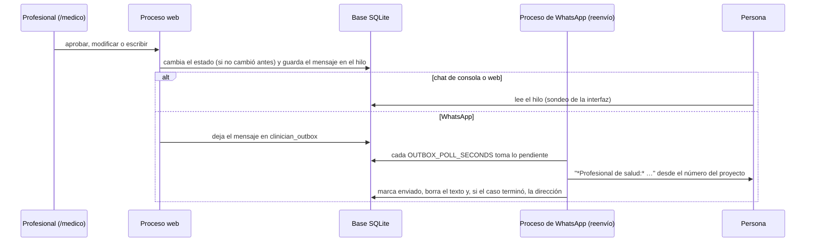

# Flujo del escalamiento al profesional de salud (HU-16)

*Última actualización: 2026-11-22*

Ciclo de vida de un caso (ADR 0022) y de la dirección temporal de WhatsApp (ADR 0023). Las transiciones están en `domain/escalation.py::TRANSITIONS`.

```mermaid
stateDiagram-v2
    [*] --> pendiente: turno sin evidencia y sin alarma\n(aviso de espera; en WhatsApp se guarda la dirección)
    pendiente --> pendiente: otro turno sin evidencia\n(recordatorio; renueva el plazo)
    pendiente --> aprobada: el profesional aprueba el borrador
    pendiente --> modificada: el profesional envía su versión
    pendiente --> en_contacto: contacto directo
    en_contacto --> en_contacto: mensajes de la persona y del profesional\n(sin modelo; renueva el plazo; el filtro 1 sigue)
    en_contacto --> cerrada: el profesional cierra el contacto
    pendiente --> expirada: 24 h sin mensajes de la persona
    en_contacto --> expirada: 24 h sin mensajes de la persona
    aprobada --> [*]
    modificada --> [*]
    cerrada --> [*]
    expirada --> [*]
```

## Entrega del mensaje del profesional

Las alarmas nunca pasan por aquí: salen de inmediato, antes y durante el caso.
