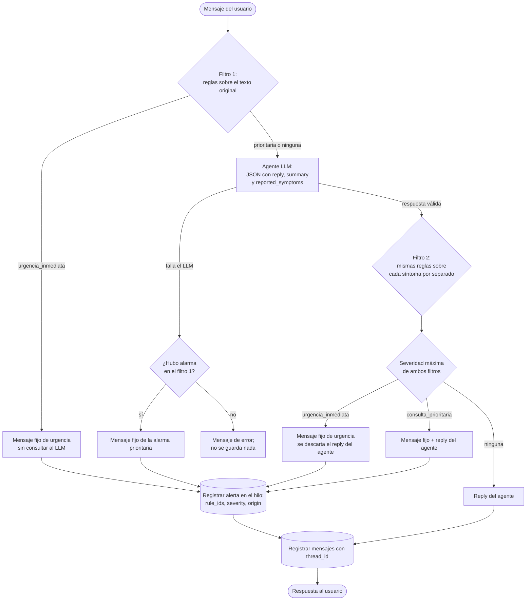

# Flujo: gestión de alerta por signos de alarma (HU-03 / HU-04)

*Última actualización: 2026-10-11*

Comportamiento implementado ([ADR 0007](../../02-arquitectura/adr/0007-alarmas-deterministas-doble-filtro.md); desde el [ADR 0008](../../02-arquitectura/adr/0008-rag-evidencia-y-dos-llamadas.md) el "Agente LLM" se divide en una llamada de **análisis sin evidencia**, que produce `reported_symptoms`, y, si no hay urgencia, el **RAG** y la **llamada de respuesta** con evidencia. Si falla la llamada de respuesta y hay alarma, se muestra el mensaje fijo). El modelo BPMN equivalente está en [`../bpmn/gestion-alerta.bpmn`](../bpmn/gestion-alerta.bpmn).

Reglas clave:
- El agente **solo suma** alarmas. Una regla detectada por los dos filtros se registra una vez, con origen `usuario`.
- No se analizan `reply` ni `summary`, porque contienen consejos que mencionan signos de alarma.
- El filtro 2 revisa **cada síntoma por separado**: el contexto de un síntoma ("en el embarazo") no se combina con el signo de otro ("fiebre en el bebé"). Así se evita el falso positivo de RN-MI-07 del 2026-10-11.
- Una urgencia del filtro 1 queda en el hilo activo **solo si es del mismo dominio**. Si no, se cierra ese hilo y se abre uno nuevo con el dominio de la regla.
- Las reglas son PROVISIONALES hasta la validación clínica (riesgo R-09).
