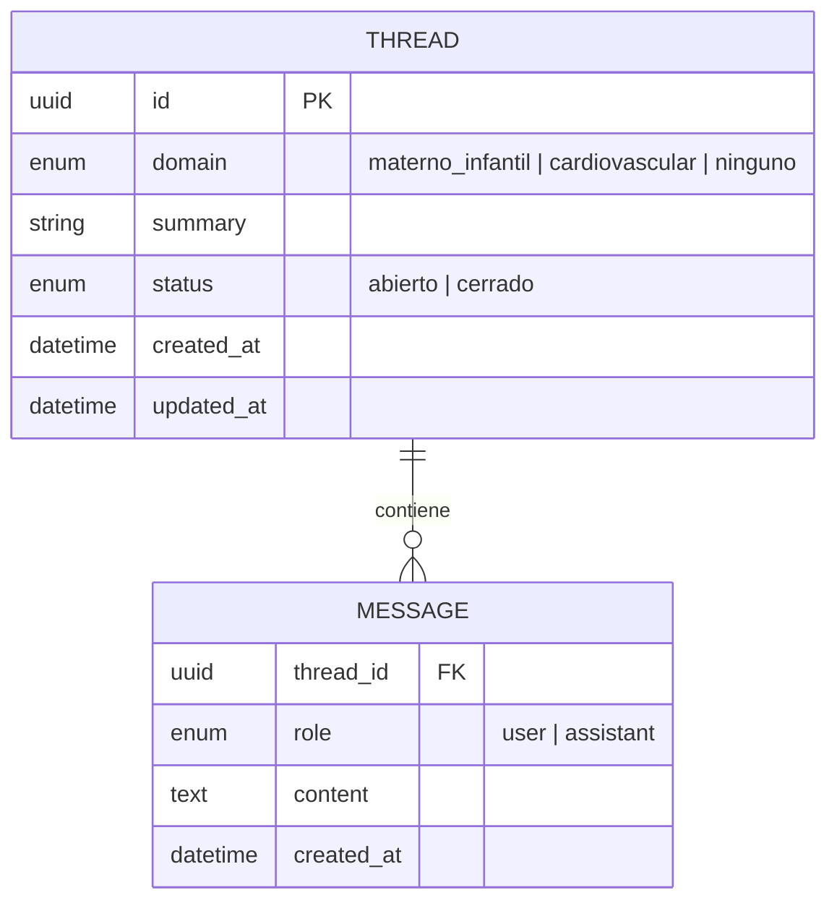
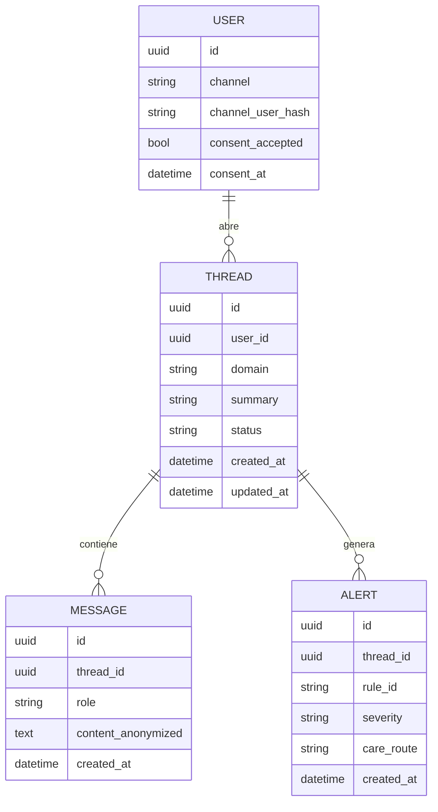

# Modelo de datos

*Última actualización: 2026-10-10*

## 1. Implementado (HU-06): hilos y mensajes en archivos JSON
Persistencia temporal en `data/threads/<thread_id>.json` (ADR 0006): un archivo por hilo, con sus mensajes embebidos. Detalle de los campos en el [diccionario de datos](diccionario-datos.md).

## 2. Objetivo (cuando se migre a base de datos para Telegram/WhatsApp)
Diseño en 3FN, con los datos personales cifrados o separados de los datos de interacción.

