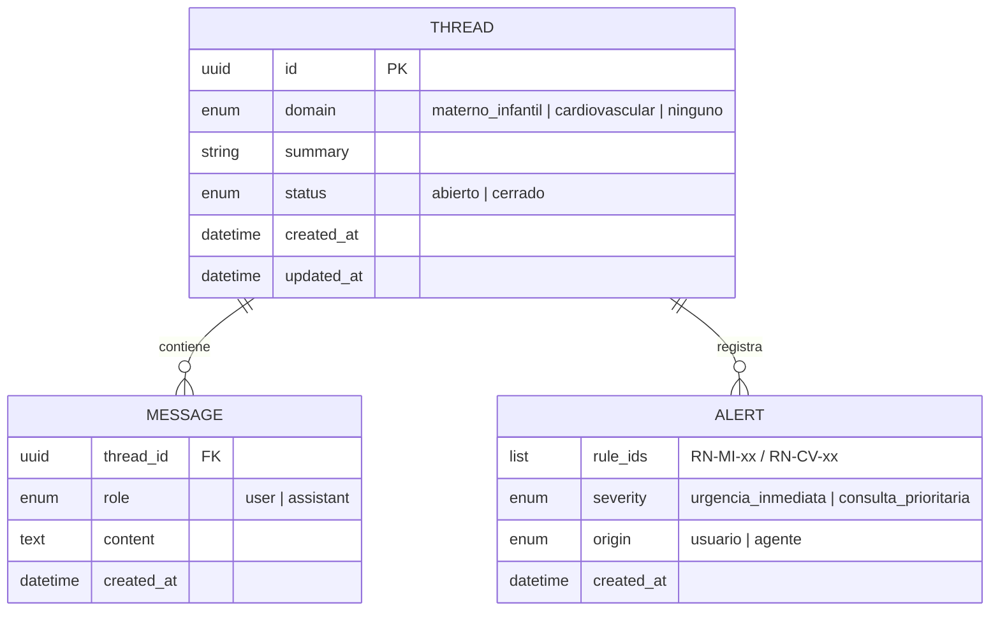
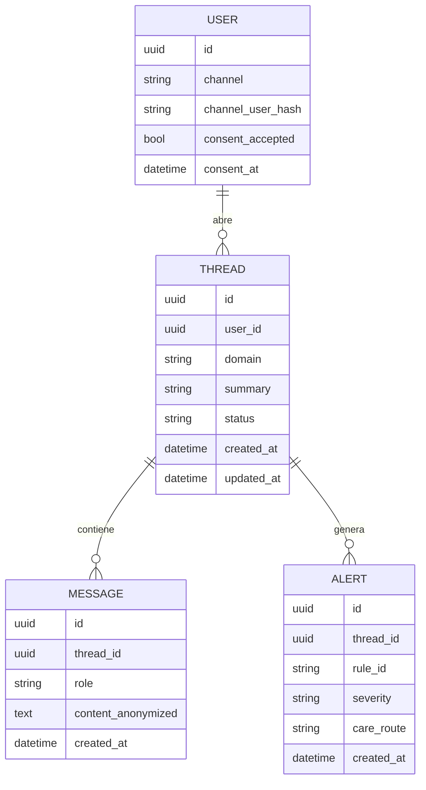

# Modelo de datos

*Última actualización: 2026-10-10*

## 1. Implementado (HU-06, HU-03/04): hilos, mensajes y alertas en archivos JSON
Persistencia temporal en `data/threads/<thread_id>.json` (ADR 0006): un archivo por hilo, con sus mensajes embebidos. Detalle de los campos en el [diccionario de datos](diccionario-datos.md).

Cada mensaje del asistente puede llevar un objeto `trace` (síntomas, evidencia, citas, tiempos y verificación del respaldo). La base de conocimiento (`KNOWLEDGE_ENTRY`) es un archivo versionado (`knowledge/kb/entries.jsonl`) y la traza la referencia por `entry_id`.

Las reglas de alarma no se persisten como entidad: son un catálogo versionado (`knowledge/alarm_rules.json`) y las alertas guardan sus `rule_ids`.

## 2. Objetivo (cuando se migre a base de datos para Telegram/WhatsApp)
Diseño en 3FN, con los datos personales cifrados o separados de los datos de interacción.

