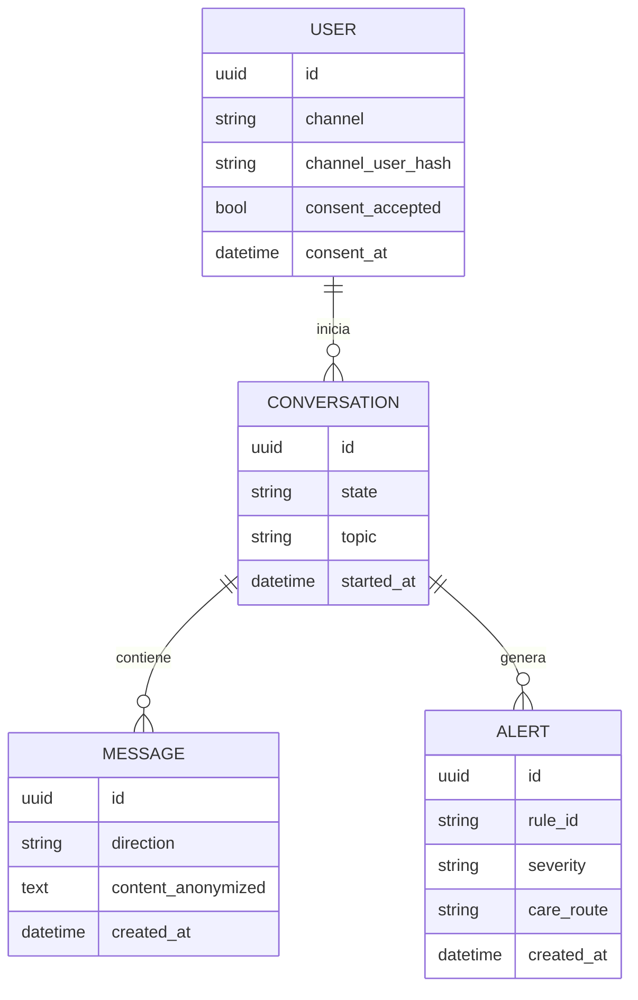

# Modelo de datos (preliminar)

*Última actualización: 2026-10-09*

TODO: se definirá al implementar la persistencia (pendiente de ADR sobre el motor de base de datos). Diseño en 3FN y datos personales cifrados o separados de los datos de interacción.

