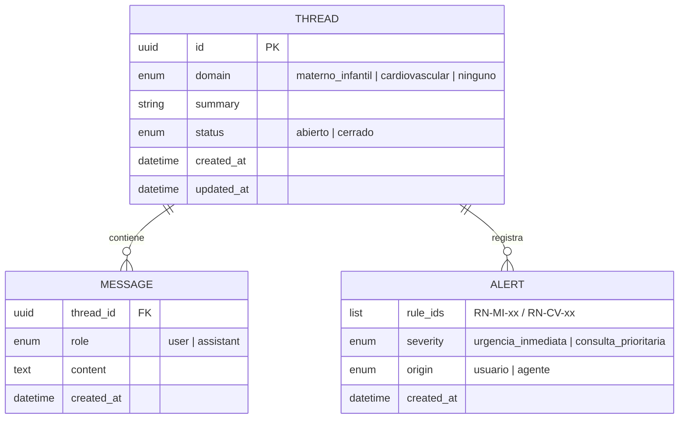
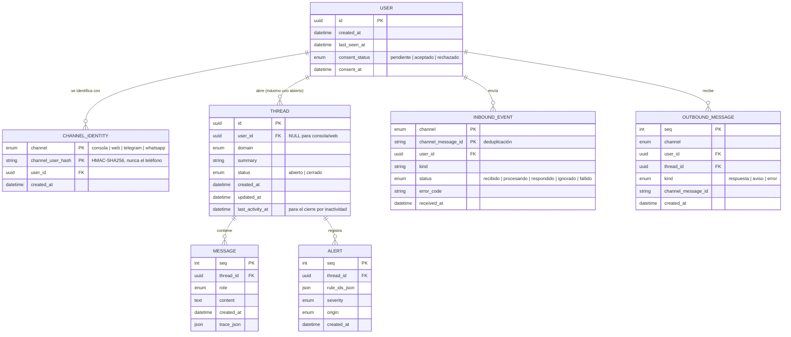

# Modelo de datos

*Última actualización: 2026-10-17 (HU-09, ADR 0015)*

## 1. Implementado (HU-06, HU-03/04): hilos, mensajes y alertas en archivos JSON
Persistencia temporal en `data/threads/<thread_id>.json` (ADR 0006): un archivo por hilo, con sus mensajes embebidos. Detalle de los campos en el [diccionario de datos](diccionario-datos.md).

Cada mensaje del asistente puede llevar un objeto `trace` (síntomas, evidencia, citas, tiempos y verificación del respaldo). La base de conocimiento (`KNOWLEDGE_ENTRY`) es un archivo versionado (`knowledge/kb/entries.jsonl`) y la traza la referencia por `entry_id`.

Las reglas de alarma no se persisten como entidad: son un catálogo versionado (`knowledge/alarm_rules.json`) y las alertas guardan sus `rule_ids`.

## 2. Implementado (HU-09, fase 2): usuarios e hilos por usuario en SQLite
Base `DATABASE_PATH` (por defecto `data/cardio_materno.db`, ignorada por git), esquema versionado con `PRAGMA user_version` (ADR 0015). Adaptadores en `adapters/outbound/persistence/sqlite_*.py`. La consola y la web siguen con JSON (§1); el canal de WhatsApp (fase 3) usará esta base.

Reglas:
- **Aislamiento:** el agente solo accede a los hilos a través de un `ThreadRepository` acotado a un `user_id` (`SqliteThreadRepository`); un usuario no puede leer ni escribir hilos de otro.
- **Un solo hilo abierto por usuario:** índice único parcial `one_open_thread_per_user`.
- **Sin texto en los eventos:** `inbound_events` y `outbound_messages` guardan identificadores, tipos y estados; el texto solo vive en `messages` (como en el JSON).
- **Sin datos de contacto:** no se guardan el teléfono ni el nombre de perfil (`proteccion-datos.md`).

## 3. Pendiente
- `MESSAGE.content_anonymized` (anonimizar antes de guardar), `ALERT.care_route` (HU-05) y el consentimiento (HU-01).
- Política de retención y borrado por usuario.